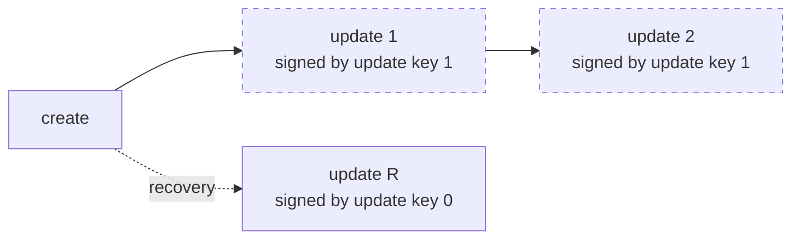
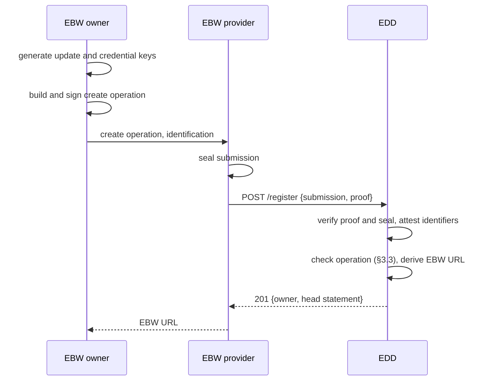

# SCC Discovery: EBW URLs and the European Digital Directory

**Element:** Discovery · **Schemas:** [`schemas/discovery.cddl`](schemas/discovery.cddl), [`schemas/edd.openapi.yaml`](schemas/edd.openapi.yaml)

## 1. Introduction

Each EBW owner has a digital address: an **EBW URL**, such as
`ebw:bo6frcnfdr54irr3eybahmh6`. The part after `ebw:` is derived from a
hash of the operation that created it. The European Digital Directory
(EDD) stores, for each EBW URL, a log of signed operations. The latest
valid operation sets the URL's **registry document**, which holds:

- the **update keys** that may sign later operations;
- the **credential keys** that may sign endpoint credentials (doc 2);
- the owner's **home RDS**;
- the owner's **existing identifiers**, such as an EUID or VAT number;
- the owner's **acceptance policies**.

The EDD also signs two kinds of statement:

- an **identifier attestation**, which binds an existing identifier to an
  EBW URL;
- a **head statement**, which gives the current head of an EBW URL's log and
  the owner's lifecycle status.

Operations are signed by the owner's update keys. The owner's EBW
provider submits them to the EDD on the owner's behalf, and seals each one
when it submits it (§3.6).

The scheme is based on the Public Ledger of Credentials (PLC) used by the
AT Protocol. The main differences are CBOR/COSE encoding, the EDD in
place of the PLC directory, provider seals on submissions, EDD-attested
identifiers, and EDD-managed lifecycle status.

### 1.1 Trust in the EDD

The EDD cannot forge or corrupt a registry document, because every
operation is signed by an update key. Relying parties can check a
registry document without trusting the EDD. The EDD is trusted only:

1. not to refuse valid operations;
2. not to serve stale registry documents, or withhold operations when
   serving a log;
3. not to falsely attest identifier mappings;
4. to report lifecycle status correctly.

Points 1 and 2 can be checked by auditing the log (§6.4), but not
prevented. Head statements limit how stale a registry document can be
(§5.2). Points 3 and 4 rest on the EDD's role under the draft EBW
Regulation (Article 8.4).

## 2. EBW URLs

An EBW URL uses the `ebw` scheme. Its path is 24 lowercase base32
characters:

```
ebw-url = "ebw:" 24( %x61-7A / %x32-37 )   ; lowercase base32
```

The path is derived from the signed create operation (§3):

```
url = "ebw:" || base32lower(SHA-256(create_operation))[0..24]
```

where `create_operation` is the encoded COSE_Sign1 of the create
operation, and `base32lower` is RFC 4648 base32 with lowercase letters and
no padding. The 24 characters carry 120 bits. The EDD MUST reject a create
operation whose EBW URL is already registered.

## 3. Operations

An operation is a COSE_Sign1. Its payload is an `op-body`:

```cddl
op-body = create-op / update-op / close-op

create-op = {
  "type": "create",
  "prev": null,
  registry-document,
}

update-op = {
  "type": "update",
  "prev": op-hash,
  registry-document,
}

close-op = {
  "type": "close",
  "prev": op-hash,
}

registry-document = (
  "update_keys": [1*5 COSE_Key],
  "credential_keys": [1*5 COSE_Key],
  "rds": rds-url,
  "identifiers": [* identifier],
  "acceptance_policies": acceptance-policies,
  "signed_at": time,
)
```

Each create or update operation carries the **complete** registry
document, not a change. This keeps each registry document readable
without replaying the log.

`op-hash` is SHA-256 over the encoded COSE_Sign1 of an operation. It is the
operation's identifier.

### 3.1 Signing

The protected header of the COSE_Sign1 MUST contain:

| Label | Value |
|---|---|
| `alg` (1) | `-8` (EdDSA) or `-7` (ES256) |
| `kid` (4) | COSE Key Thumbprint of the signing key |

The signing key MUST be one of:

- for a create operation: the operation's own `update_keys`;
- for any other operation: the `update_keys` of the registry document
  set by the operation named in `prev`.

### 3.2 Fields

**`update_keys`** — keys that may sign operations, in order of priority.
Index 0 has the highest priority. Priority matters only for recovery
(§3.4).

**`credential_keys`** — keys that may sign endpoint credentials. They
SHOULD NOT also be update keys.

**`rds`** — the owner's home RDS, identified by the URL of its metadata
(doc 4 §3):

```cddl
rds-url = tstr .regexp "https://.+"
```

**`identifiers`** — existing identifiers the owner claims. The EDD MUST
NOT accept an operation that adds an identifier until it has attested that
identifier for this EBW URL (§4).

```cddl
identifier = {
  "type": identifier-type,
  "value": tstr,
}
identifier-type = "euid" / "lei" / "vat" / "eori" / "iso6523"
```

| Type | Value | Example |
|---|---|---|
| `euid` | European Unique Identifier (BRIS) | `DEHRB.HRB123456` |
| `lei` | Legal Entity Identifier (ISO 17442) | `5299000J2N45DDNE4Y28` |
| `vat` | EU VAT number with country prefix | `DE123456789` |
| `eori` | EORI number | `DE1234567890123` |
| `iso6523` | ISO 6523 ICD and identifier, separated by `:` | `0007:5567164818` |

**`acceptance_policies`** — how many holders of a role must accept a
message sent in `consented` mode (doc 4 §7.4):

```cddl
acceptance-policies = {
  "default": acceptance-policy,
  * tstr => acceptance-policy,   ; key: a role
}
acceptance-policy = "any" / "all" / quorum
quorum = [ "quorum", uint .ge 1 ]
```

| Policy | Meaning |
|---|---|
| `"any"` | One holder of the role accepts. |
| `"all"` | Every holder of the role, as of relay acceptance, accepts. |
| `["quorum", n]` | `n` distinct holders of the role accept. |

The `default` entry applies to any role without its own entry. Holders
are counted, not endpoints (doc 2 §2).

**`signed_at`** — the time the owner signed the operation. It is
informational. The EDD records its own receipt time (§6.4).

### 3.3 Validity

The EDD MUST accept an operation only if all of these hold:

1. It is a valid COSE_Sign1, with a deterministically encoded payload
   matching `op-body`, in a valid submission (§3.6).
2. The signature verifies with a key allowed by §3.1.
3. `prev` names the current head, or the recovery rule (§3.4) applies.
4. The EBW URL is not closed.
5. Every identifier in the new registry document is attested for this
   EBW URL (§4).
6. `rds` is an `https` URL.

A create operation is accepted only through registration (§6.2).

### 3.4 Recovery

An update key can override recent operations signed by lower-priority
keys. This lets an owner undo changes made by a compromised or misbehaving
key, such as one held by its RDS.

An update or close operation MAY name in `prev` an operation `P`
that is not the current head, if:

1. it is signed by the update key at index `i` in the registry
   document set by `P`;
2. every operation after `P` was signed by a key with an index greater
   than `i` in the registry document that operation was checked
   against; and
3. the EDD received the first operation after `P` less than its
   recovery window ago. The EDD publishes the window in its metadata
   (§6.6).

The operations after `P` are then **overridden**. They stay in the log,
marked as overridden, and the new operation becomes the head.



### 3.5 Closing

A close operation ends the EBW URL. The EDD MUST NOT accept later
operations. Resolution returns the last registry document with status
`closed`.

### 3.6 Submission

The owner's EBW provider submits each operation to the EDD on the owner's
behalf. It seals the operation in a **submission**, a COSE_Sign1:

```cddl
submission-body = {
  "type": "submission",
  "operation": bstr .cbor operation,
  "submitted_at": time,
}
```

The protected header carries `x5chain` (label 33) with the provider's
qualified certificate for electronic seals. The EDD MUST check that the
seal verifies, and that the certificate was valid and qualified when the
EDD received the submission, using the EU Trusted Lists.

The seal records which provider submitted the operation. It does not
authorize the operation: only the update key's signature does (§3.1).
The EDD keeps the submission in the log (§6.4), so an auditor can see
which provider submitted each operation.

## 4. Identifier attestations

The EDD verifies that the owner of an EBW URL is the entity known by an
existing identifier, using the identification process set by the EBW
Regulation. That process is out of scope here. The result is an
**identifier attestation**, a COSE_Sign1 signed by the EDD:

```cddl
identifier-attestation-body = {
  "type": "identifier-attestation",
  "identifier": identifier,
  "owner": ebw-url,
  "verified_at": time,
  "expires_at": time,
}
```

Rules:

- An identifier maps to at most one EBW URL at a time. The EDD MUST revoke
  an attestation before attesting the same identifier to another EBW URL.
- An owner MAY remove an identifier from its registry document at any
  time. The
  attestation stays valid until the EDD revokes it.
- Lookup (§6.3) returns the current attestation. A revoked attestation is
  not returned.
- An attestation is valid from `verified_at` until `expires_at`. The EDD
  issues a new one before the current one expires, for as long as the
  mapping holds.

## 5. Head statements and lifecycle

### 5.1 Status

The EDD manages the owner's lifecycle status. It sits beside the log,
not in it, because the EDD sets it, not the owner.

| Status | Meaning | Effect on SCC |
|---|---|---|
| `active` | Normal operation | Messages can be sent and delivered. |
| `suspended` | Temporarily barred, e.g. by a court order | RDSes hold in-flight messages and reject new ones. Held messages expire normally. |
| `retired` | The entity no longer exists | Messages fail with reason `recipient-retired`. |
| `merged` | The entity merged into another | Messages fail with reason `recipient-merged`. The statement names the successor EBW URL. |
| `closed` | The owner closed the EBW URL | As `retired`. |

### 5.2 Head statement

A head statement is a COSE_Sign1 signed by the EDD:

```cddl
head-statement-body = {
  "type": "head-statement",
  "owner": ebw-url,
  "head": op-hash,
  "seq": uint,                ; number of non-overridden operations
  "status": owner-status,
  ? "successor": ebw-url,         ; present if status is "merged"
  "issued_at": time,
  "expires_at": time,
}
owner-status = "active" / "suspended" / "retired" / "merged" / "closed"
```

The statement is valid from `issued_at` until `expires_at`. The EDD
chooses the interval. A short one makes status changes take effect
sooner, at the cost of RDSes fetching statements more often.

An RDS MUST hold an unexpired head statement with status `active` for
both owners before it issues evidence that a message was submitted,
relayed, accepted or handed over (doc 5). The evidence includes the head
statements it relied on. This lets a verifier see which registry
document was in force, and therefore which credential keys and
acceptance policy applied.

If the EDD is unreachable, an RDS MAY rely on a head statement until it
expires. After that it MUST stop issuing such evidence. In-flight messages
are held until they expire.

### 5.3 EDD keys

The EDD signs with keys certified by qualified certificates for electronic
seals (QSealC). Its current and past keys are published at
`/.well-known/edd` (§6.6). Each signature's protected header carries
`x5chain` (label 33) with the certificate chain.

## 6. EDD API

The EDD offers an HTTPS API. Request and response bodies are CBOR
(`application/cbor`), except the EDD metadata (§6.6), which is JSON.
Errors use Concise Problem Details (RFC 9290,
`application/concise-problem-details+cbor`). The full contract is in
[`schemas/edd.openapi.yaml`](schemas/edd.openapi.yaml).

| Operation | Method and path | Returns |
|---|---|---|
| Resolution | `GET /{url}` | Registry document and head statement |
| Head | `GET /{url}/head` | Head statement |
| Auditing | `GET /{url}/log` | Log entries |
| Lookup | `GET /lookup/{type}/{value}` | Identifier attestation |
| Registration | `POST /register` | EBW URL and head statement |
| Update | `POST /{url}` | Head statement |
| EDD metadata | `GET /.well-known/edd` | EDD keys and limits (JSON) |

`{url}` is the whole EBW URL, for example
`GET /ebw:bo6frcnfdr54irr3eybahmh6`. All reads are public. Signed objects
state their own validity, and MUST NOT be relied on outside it. For other
responses, clients follow the HTTP caching headers the EDD sends.

### 6.1 Resolution

`GET /{url}` returns the current registry document, in the operation
that set it, with a current head statement:

```cddl
resolution-response = {
  "operation": bstr .cbor operation,  ; the head operation
  "head": bstr .cbor head-statement,
}
```

The client checks that the head statement verifies, names the URL, and
names the operation as its head. It then has the registry document
without trusting the EDD for its content. A client that needs to know
how the registry document came about fetches the log (§6.4).

### 6.2 Registration

`POST /register` creates an EBW URL. The body is:

```cddl
registration-request = {
  "submission": bstr .cbor submission,  ; of a create operation
  "proof": bstr,              ; evidence of identification, EDD-defined
}
```

The EDD verifies `proof` under its identification process, attests the
identifiers in the create operation, and stores the submission. The proof
is not stored in the log, which is public. The EDD returns the EBW URL
and the first head statement.



### 6.3 Lookup

`GET /lookup/{type}/{value}` returns the identifier attestation for an
existing identifier, or 404. The `value` is percent-encoded.

### 6.4 Auditing

`GET /{url}/log` returns every operation for the EBW URL in order,
including overridden ones, in the submissions that carried them:

```cddl
log = [+ log-entry]
log-entry = {
  "submission": bstr .cbor submission,
  "received_at": time,        ; EDD receipt time
  "overridden": bool,
}
```

The optional query parameter `after` (a hex `op-hash`) returns only later
entries.

An auditor checks that:

1. the first entry is a create operation whose hash gives the EBW URL;
2. each entry is valid under §3.3 against the registry document before
   it, or is a valid recovery (§3.4), and its submission seal verifies
   (§3.6);
3. the head in a recent head statement is the last non-overridden entry.

Auditors SHOULD compare logs fetched at different times and from
different vantage points. A log that shrinks, or two logs that disagree
on an operation's successor, shows the EDD misbehaving.

### 6.5 Update

`POST /{url}` submits an update or close operation, in an encoded
submission (§3.6). The EDD checks it (§3.3) and returns the new head
statement.

| Error | Status | Problem type |
|---|---|---|
| Malformed submission or operation | 400 | `malformed-operation` |
| Seal does not verify, or certificate not qualified | 403 | `invalid-seal` |
| Bad signature or key not allowed | 403 | `unauthorized-key` |
| `prev` is not the head and recovery does not apply | 409 | `stale-prev` |
| Identifier not attested | 422 | `identifier-not-attested` |
| EBW URL closed | 410 | `closed` |

### 6.6 EDD metadata

`GET /.well-known/edd` returns JSON:

```json
{
  "edd": "https://edd.europa.eu",
  "seal_certificates": [
    {"x5c": ["MIIC...", "MIID..."], "not_before": "2026-01-01T00:00:00Z", "not_after": "2028-01-01T00:00:00Z"}
  ],
  "identifier_types": ["euid", "lei", "vat", "eori", "iso6523"],
  "recovery_window": 604800
}
```

## 7. Caching and freshness

No time is fixed by this specification. Each object says how long it
may be used:

| Item | Usable until |
|---|---|
| Head statement | Its `expires_at` |
| Identifier attestation | Its `expires_at`, unless revoked earlier |
| Registry document | The `expires_at` of the head statement that names it |
| Log | As the HTTP caching headers say |

An endpoint MAY keep using a cached registry document to build a session
while the EDD is unreachable. RDSes enforce freshness for evidence
(§5.2).

## 8. Example

A create operation, in CBOR diagnostic notation (payload shown decoded):

```
/ COSE_Sign1 / [
  / protected / << { 1: -8, 4: h'5c1f...a7' } >>,
  / unprotected / {},
  / payload / << {
    "type": "create",
    "prev": null,
    "update_keys": [
      { 1: 1, -1: 6, -2: h'd75a...511a' },
      { 1: 1, -1: 6, -2: h'3d40...660c' }
    ],
    "credential_keys": [ { 1: 1, -1: 6, -2: h'fc51...d025' } ],
    "rds": "https://rds.example-provider.eu/scc-rds",
    "identifiers": [ { "type": "vat", "value": "DE123456789" } ],
    "acceptance_policies": { "default": "any",
                             "contracts": ["quorum", 2] },
    "signed_at": 1792310400
  } >>,
  / signature / h'8eb3...'
]
```

Complete examples are in [`examples/`](examples/): `create-op.diag`,
`submission.diag`, `head-statement.diag` and
`identifier-attestation.diag`.

## 9. Security considerations

- **Update key custody.** An owner SHOULD hold its highest-priority
  update key offline. A lower-priority key MAY be held by the RDS for
  routine updates. The owner can then undo the RDS's changes within the
  recovery window.
- **Withholding.** The EDD could serve different logs to different
  parties. Head statements are signed, so two conflicting statements for
  the same `seq` are proof of misbehaviour.
- **Status timing.** A suspension can be hidden until the last head
  statement showing `active` expires. The EDD controls this delay through
  the validity it gives head statements.
- **Privacy.** The registry document is public. It names the RDS, the
  identifiers and role names used in policies. It does not list
  endpoints or holders. Endpoint revocation is not recorded here but in
  status lists (doc 2 §5.3).
