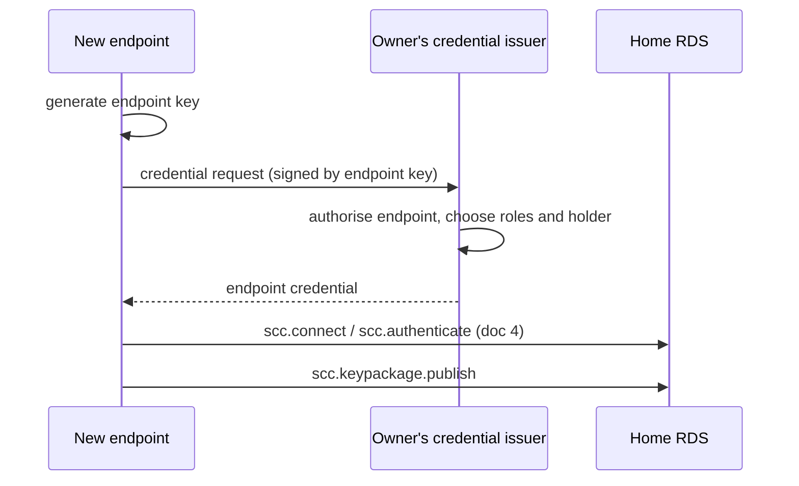

# SCC Endpoint Credentials

**Element:** Discovery, E2E · **Schema:** [`schemas/credentials.cddl`](schemas/credentials.cddl)

## 1. Introduction

An endpoint proves that it belongs to an EBW owner and holds certain roles
by presenting an **endpoint credential**. The credential is signed by one
of the owner's credential keys (doc 1). It certifies a long-lived
**endpoint key**. The endpoint key in turn signs over the endpoint's MLS
signature key.

```
  registry document (EDD)     endpoint credential             MLS LeafNode
 +------------------+         +---------------------+        +------------------+
 | credential_keys -+--signs->| iss: EBW URL        |        | signature_key  <-+--+
 +------------------+         | sub: subject ID     |        | credential:      |  |
                              | roles, holder       |        |   MultiCredential|  |
                              | cnf: endpoint key --+--signs-+-> binding -------+--+
                              +---------------------+        +------------------+
```

This indirection has two purposes:

- MLS signature keys can rotate freely (with every KeyPackage, if
  desired) without a new credential from the owner.
- The endpoint key outlives MLS keys, so it can sign decryption reports
  and consent decisions that must be checked years later (doc 5).

The credential key MUST be controlled by the EBW owner, not by its RDS.
This is what prevents an RDS from inventing endpoints.

## 2. Endpoint credential

An endpoint credential is a CBOR Web Token (CWT, RFC 8392): a COSE_Sign1
whose payload is a claims set.

```cddl
endpoint-claims = {
  1 => ebw-url,                   ; iss: the EBW owner's EBW URL
  2 => subject-id,            ; sub: the subject ID
  4 => time,                  ; exp
  5 => time,                  ; nbf
  6 => time,                  ; iat
  8 => { 1 => COSE_Key },     ; cnf: the endpoint key
  65535 => credential-status, ; status: where to check revocation
  "roles" => [+ role],
  ? "holder" => holder-id,
}

credential-status = {
  "status_list": {
    "idx": uint,              ; this credential's index in the list
    "uri": tstr .regexp "https://.+",   ; where the status list is
  },
}
holder-id = tstr .size (1..64)
```

| Claim | Meaning |
|---|---|
| `iss` | The EBW URL of the EBW owner. |
| `sub` | The subject ID: an opaque identifier for the endpoint, unique within the EBW URL. |
| `nbf`, `exp` | Validity period, chosen by the owner. |
| `iat` | Issue time. |
| `cnf` | The endpoint key (RFC 8747), as a COSE_Key. |
| `status` | A pointer to the credential's entry in a status list (§5.3). |
| `roles` | The roles this endpoint holds. No duplicates. |
| `holder` | The person or system the endpoint acts for. If absent, the holder is the endpoint itself. |

The subject ID plays the role of `sub` in a JWT. It identifies the
endpoint to RDSes and to other endpoints, which compare it against lists
of subject IDs (doc 3 §5). The owner chooses it. It MUST be opaque: it
SHOULD be 16 random bytes, base64url-encoded, and MUST NOT carry meaning
or personal data. An endpoint keeps its subject ID when its credential is
renewed or its endpoint key rotated.

The holder is also an opaque, pseudonymous identifier chosen by the owner.
It MUST NOT contain personal data. Endpoints of the same person SHOULD share
a holder, so that acceptance policies count that person once (doc 4
§7.4).

The protected header MUST contain `alg` and `kid`, where `kid` is the COSE
Key Thumbprint of the credential key.

### 2.1 Example

```
/ COSE_Sign1 / [
  << { 1: -8, 4: h'a1b2...c3' } >>,
  {},
  << {
    1: "ebw:baar3g6q3z7rabmz5w4soq43",
    2: "Kq7vT2mXr9Lp",
    4: 1794902400,
    5: 1792310400,
    6: 1792310400,
    8: { 1: { 1: 1, -1: 6, -2: h'8f40...2b9e' } },
    65535: { "status_list": { "idx": 7,
             "uri": "https://status.example-provider.eu/baar3g6q/1" } },
    "roles": ["default", "purchasing"],
    "holder": "h-41c9"
  } >>,
  h'5d0e...'
]
```

The full example is [`examples/endpoint-credential.diag`](examples/endpoint-credential.diag).

## 3. Verifying a credential

Given a credential and a time `t`, a verifier:

1. Decodes the COSE_Sign1 and claims. The payload MUST be
   deterministically encoded.
2. Gets the registry document for `iss` that was in force at `t` (doc 1). For
   current checks this is the current state.
3. Finds the credential key whose thumbprint equals `kid` in
   `credential_keys`. If none, the credential is invalid.
4. Verifies the signature.
5. Checks `nbf <= t < exp`.
6. Checks the credential's status in its status list (§5.3): gets a
   status list token for the `uri` that was current at `t`, and checks
   that the entry at `idx` is VALID.

Checks of past acts (for example, a decryption report signed two years
ago) use the time of the act, and the registry document in force then. The log
(doc 1 §6.4) supplies that state.

## 4. MLS binding

### 4.1 The `ebw_endpoint` credential type

The new MLS credential type `ebw_endpoint` (`0xF0EB`) carries an endpoint
credential:

```tls
struct {
    opaque cwt<V>;   /* encoded COSE_Sign1 of an endpoint credential */
} EBWEndpointCredential;

struct {
    CredentialType credential_type;
    select (Credential.credential_type) {
        /* ... types from RFC 9420 and draft-ietf-mls-extensions ... */
        case ebw_endpoint:
            EBWEndpointCredential ebw_endpoint;
    };
} Credential;
```

An `ebw_endpoint` credential "corresponds to" a public key (in the sense of
RFC 9420 §5.3) if that key equals the `cnf` key.

### 4.2 The leaf credential

Every SCC LeafNode MUST use a credential of type `multi` (draft-ietf-mls-
extensions §6.5) with exactly one `CredentialBinding`:

```tls
struct {
    CipherSuite cipher_suite;
    Credential credential;              /* type ebw_endpoint */
    SignaturePublicKey credential_key;  /* the endpoint key */
    opaque signature<V>;                /* by the endpoint key */
} CredentialBinding;
```

| Field | Value |
|---|---|
| `cipher_suite` | A cipher suite whose signature scheme matches the endpoint key's algorithm. |
| `credential` | The `ebw_endpoint` credential. |
| `credential_key` | The endpoint key, in the encoding the cipher suite uses for signature keys. |
| `signature` | `SignWithLabel(endpoint_private_key, "CredentialBindingTBS", CredentialBindingTBS)` |

The binding signature is made with the endpoint key (`credential_key`)
and verified with it. Its signed content, `CredentialBindingTBS`, covers
the binding's fields and the LeafNode's `signature_key`
(draft-ietf-mls-extensions §6.5.1). So the endpoint key vouches for the
MLS signature key.

The endpoint key's algorithm MUST be Ed25519 or P-256. It need not match
the MLS group's cipher suite, but every member must support the binding's
cipher suite (draft-ietf-mls-extensions §6.5.2). In practice an endpoint
SHOULD use the same algorithm for its endpoint key and its MLS signature
key.

### 4.3 Verifying a LeafNode

A member, or an RDS, accepts a LeafNode only if:

1. Its credential has type `multi` with exactly one binding.
2. The binding's credential has type `ebw_endpoint`.
3. The endpoint credential is valid now (§3).
4. `credential_key` equals the credential's `cnf` key.
5. The binding signature verifies under `credential_key` over
   `CredentialBindingTBS` with the LeafNode's `signature_key`.
6. The LeafNode itself is valid under RFC 9420 §7.3.

The identity of the leaf is the pair (`iss`, `sub`). Two leaves in a
group MUST NOT have the same identity.

### 4.4 Capabilities

Every SCC LeafNode MUST list, in `capabilities.credentials`, the types
`multi` and `ebw_endpoint`, and in `capabilities.extensions`, the type
`scc_session` (doc 3).

## 5. Lifecycle

### 5.1 Enrolment

Enrolment happens inside the EBW owner's organisation. The owner chooses
how to authenticate a new endpoint. This section gives a common format
for the request so that wallet software and the owner's administration
tools can interoperate. Its use is OPTIONAL.



A credential request is a COSE_Sign1 signed by the new endpoint key:

```cddl
credential-request-body = {
  "type": "credential-request",
  "owner": ebw-url,
  ? "subject": subject-id,   ; requested; the issuer may assign another
  "roles": [* role],              ; requested; the issuer decides
  "key": COSE_Key,                ; the endpoint key
  "nonce": bstr .size (16..32),   ; from the issuer, to prevent replay
}
```

### 5.2 Renewal

An endpoint MUST obtain a new credential before its current one expires.
It then updates its LeafNode in every session it belongs to, using an
Update proposal or a Commit with an UpdatePath (doc 3). Its KeyPackages
MUST carry the new credential.

### 5.3 Revocation

Credentials are revoked with an OAuth Token Status List
(draft-ietf-oauth-status-list-21). Each credential points to an entry in
a status list with its `status` claim (§2). The owner publishes the list
as a **status list token**: a CWT signed with one of its credential keys,
listing the status of every credential that points to it.

```cddl
status-list-token = #6.18([cose-protected, cose-unprotected,
                           payload: bstr .cbor status-list-claims,
                           cose-signature])

status-list-claims = {
  1 => ebw-url,                   ; iss: the EBW owner's EBW URL
  2 => tstr,                  ; sub: the status list URI
  6 => time,                  ; iat
  4 => time,                  ; exp
  ? 5 => time,                ; nbf
  ? 65534 => uint,            ; ttl, in seconds
  65533 => status-list,       ; status_list
}

status-list = {
  "bits": 1 / 2,
  "lst": bstr,                ; ZLIB-compressed array of statuses
}
```

The rules of the draft apply. In particular:

- The token is a tagged COSE_Sign1 (tag 18), whose protected header has
  `typ` (16) = `"application/statuslist+cwt"`, as well as `alg` and
  `kid`. `kid` MUST name one of the owner's credential keys. This is the
  one SCC signature that is tagged, because the draft requires it.
- `sub` MUST equal the `uri` in the credentials that point to the list.
- Each credential has its own `idx`. The statuses are VALID (0), INVALID
  (1, revoked) and SUSPENDED (2). A list that needs SUSPENDED uses
  `bits` = 2.
- The token is served at its URI over HTTPS, with content type
  `application/statuslist+cwt`. The owner may host it, or have its RDS
  or another provider host it. The host cannot change it, because it is
  signed with the owner's credential key.

Each token states its own validity period. SCC sets no fixed times:

- The token MUST have `exp`, and MAY have `nbf` (5). The draft only
  recommends `exp`; SCC requires it. It MAY also have `ttl`, which says
  how long a copy may be cached.
- The owner chooses the period. A shorter period means revocations take
  effect sooner, at the cost of signing new tokens more often. The owner
  MUST publish a new token before the current one expires, even if nothing
  has changed.
- An RDS checking membership (doc 3 §5) MUST use a token that is valid
  now (`nbf` ≤ now < `exp`) and, if it has a `ttl`, was fetched within
  it. It MUST treat a credential as invalid if it cannot get such a
  token.

To revoke an endpoint, the owner sets its entry to INVALID and publishes
a new token. RDSes see the change when their cached copy runs out: at
the token's `ttl`, or at its `exp` if it has no `ttl`. The endpoint is then
removed from each session the next time a message is sent in it.

**Status in evidence.** Evidence that relies on an endpoint's credential
embeds the status list token that the RDS checked (doc 5 §3.1). A
verifier can then check, years later, that the credential was valid
when the endpoint acted, without asking the host for an old list.
Hosts MAY also support the draft's `time` query for historical lists.

**Compromised credential keys.** If a credential key is compromised, the
attacker could sign both credentials and status lists. The owner then
removes the key from its registry document (doc 1 §3), which invalidates
everything signed with it for current checks. This is a change to the
owner's own keys, so it belongs in the registry document. Revoking individual
endpoints does not.

### 5.4 Endpoint key rotation

An endpoint rotates its endpoint key by enrolling again with a new key. It
keeps its subject ID. Old reports stay verifiable, because they are
checked against the credential that was valid when they were signed.

## 6. Security considerations

- **RDS impersonation.** An RDS holds no credential key, so it cannot
  create endpoint credentials. It could replay old KeyPackages, which
  single-use rules and expiry limit (doc 3 §3).
- **Lost endpoint.** Revoking the endpoint (§5.3) removes it from future
  epochs of every session, once cached status lists run out. It can still
  read messages it already received.
- **Status privacy.** A status list host learns which lists are fetched,
  and when. Lists are per owner, not per endpoint, so a fetch does not
  reveal which endpoint is being checked.
- **Holder correlation.** Holder IDs are visible to RDSes and to all
  members of a session. Owners SHOULD use per-holder random values, not
  employee numbers.
