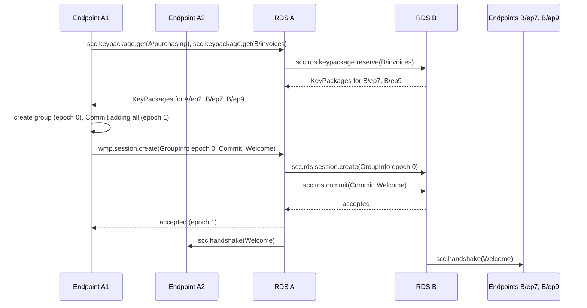
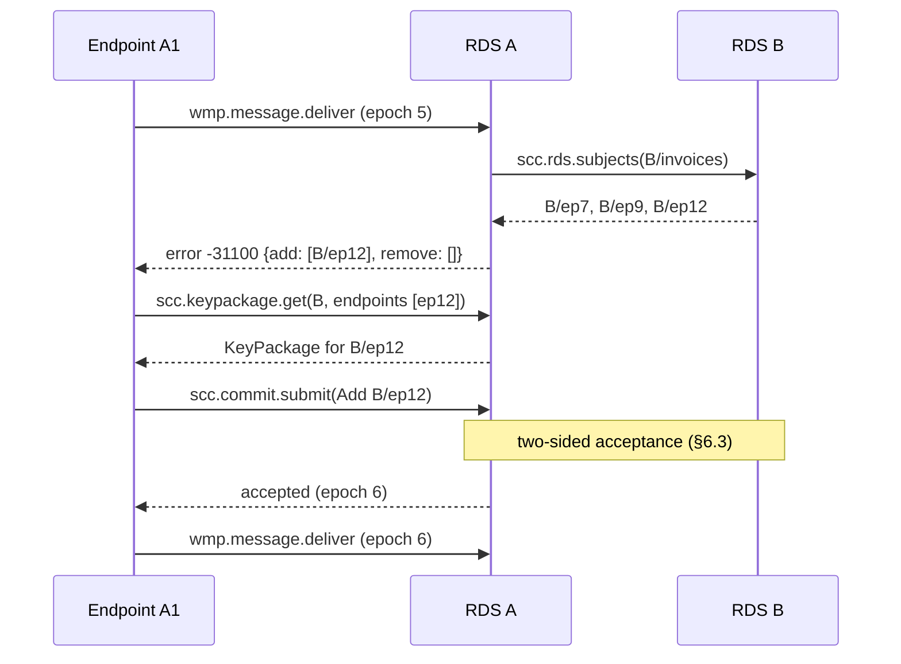
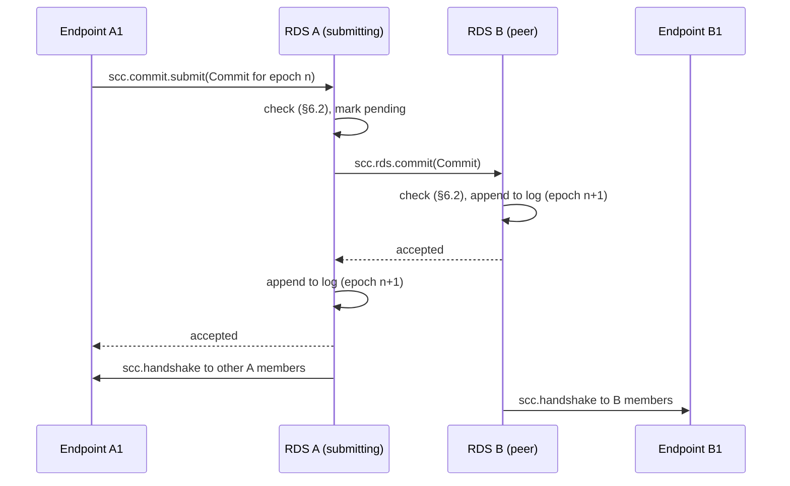

# SCC MLS Profile

**Element:** E2E Encryption · **Schema:** [`schemas/mls.cddl`](schemas/mls.cddl)

## 1. Introduction

SCC encrypts messages end to end with MLS (RFC 9420). This document
profiles MLS for SCC. Its main features are:

- A **session** is one MLS group between two addresses. Any endpoint may
  start a new session at any time.
- Proposals and Commits are visible to the RDSes, which keep a **Commit
  log** for each session. A Commit takes effect only when **both** RDSes
  have accepted it.
- On every send, both RDSes check that the session's members are exactly
  the endpoints that should be in it.
- Each message carries the sender's **epoch authenticator**, which
  supports dispute resolution (doc 5).

## 2. Cipher suites

| Cipher suite | Status |
|---|---|
| `MLS_128_DHKEMX25519_AES128GCM_SHA256_Ed25519` (`0x0001`) | REQUIRED |
| `MLS_128_DHKEMP256_AES128GCM_SHA256_P256` (`0x0002`) | RECOMMENDED |

The creator of a session chooses a cipher suite for which every invited
endpoint has a KeyPackage. Post-quantum suites will be added when they are
registered.

## 3. KeyPackages

An endpoint publishes KeyPackages to its home RDS (doc 4 §6). Each
KeyPackage:

- MUST have a LeafNode with an SCC credential (doc 2 §4.2);
- MUST have a `lifetime` that ends no later than the endpoint
  credential's `exp`;
- is **single use**. The RDS MUST hand out each KeyPackage at most once
  (doc 4 §6.3). An endpoint MUST reject a Welcome built on a KeyPackage it
  has already used.

An endpoint SHOULD keep at least 10 unused KeyPackages per supported
cipher suite on its home RDS, and replenish them when its RDS reports a
low pool (doc 4 §6.1).

**Last-resort KeyPackages are forbidden.** A KeyPackage carrying the
`last_resort_key_package` component (draft-ietf-mls-extensions §6.4) MUST
be rejected by RDSes and endpoints. Every KeyPackage is used once.

If an eligible endpoint has no KeyPackage, it cannot be added to a
session, so no session can be correctly formed for its address. A message
to that address is then not delivered, and the sender gets evidence of
non-delivery that names the endpoint (§5.1).

## 4. Sessions

### 4.1 Session identity

A session is an MLS group. Its **session ID** is the MLS `group_id`: 16 to
32 random bytes chosen by the creator. RDSes MUST reject a session ID that
is already in use.

Every session has the GroupContext extension `scc_session` (`0xF0EC`):

```tls
struct {
    opaque owner<V>;
    opaque role<V>;
} SCCAddress;

struct {
    SCCAddress initiator;
    SCCAddress responder;
} SCCSession;
```

`initiator` is the address of the creator's side. `responder` is the
address of the other side. The two addresses MUST differ. The extension
MUST NOT change during the session.

The GroupContext MUST also have a `required_capabilities` extension that
lists credential types `multi` and `ebw_endpoint` and extension type
`scc_session`.

A message in a session goes from one side to the other. An endpoint that
wants to talk to a different address, or that wants a fresh group for any
reason, creates a new session.

### 4.2 Membership rule

The **required members** of a session at time `t` are the endpoints that
are **eligible** for either address. Endpoints are identified by subject
ID (doc 2 §2). An endpoint is eligible for address (`owner`, `role`) at `t`
if:

1. it is registered at the home RDS of `owner` (doc 4 §5);
2. it has an endpoint credential that is valid at `t` (doc 2 §3) and lists
   `role`.

The session is **correctly formed** at `t` if:

1. the set of leaf identities (`iss`, `sub`) equals the set of required
   members, identified by (EBW URL, subject ID); and
2. every leaf's credential is valid at `t` and lists the role of the
   leaf's side.

```
 initiator address (A, purchasing)       responder address (B, invoices)
 eligible: A/ep1, A/ep2                  eligible: B/ep7, B/ep9
            \      /                                \      /
             v    v                                  v    v
      required members = { A/ep1, A/ep2, B/ep7, B/ep9 }
                               ||
                     leaves of the MLS group  ->  correctly formed
```

### 4.3 Creating a session



The creator:

1. gets KeyPackages for every eligible endpoint of both addresses, except
   itself (doc 4 §6);
2. verifies every KeyPackage and credential (doc 2 §4.3);
3. creates the group at epoch 0, with the `scc_session` and
   `required_capabilities` extensions;
4. creates a Commit that adds every other required member;
5. calls `wmp.session.create` with the epoch 0 GroupInfo (with the
   `ratchet_tree` extension), the Commit, and the Welcome.

The Welcome's GroupInfo MUST include the `ratchet_tree` extension.

### 4.4 Ending a session

Sessions have no fixed lifetime. An RDS MAY close a session that has been
idle longer than its published limit (doc 4 §3). A closed session accepts
no more Commits or messages. Its Commit log is retained for the evidence
retention period (doc 5 §8).

## 5. Membership check

Both RDSes check the session before accepting each message:

- the **sending RDS** when the sender submits it (doc 4 §7.1);
- the **receiving RDS** when it is relayed (doc 4 §7.2).

Each RDS learns its own owners' eligible endpoints from its own records.
It learns the other side's by asking the other RDS for the list of subject
IDs eligible for the address (`scc.rds.subjects`, doc 4 §9). The answer
states until when it may be used (`expires_at`), and the asking RDS MAY
cache it until then. The answering RDS stands by its answer for that
period (doc 4 §9), so a cached answer never causes a rejection at relay.
The check compares that list with the `sub` values in the leaves'
credentials. It checks each leaf's credential status in the owner's
status list (doc 2 §5.3), using a status list token that is currently
valid.

If the other RDS cannot be reached, and the sending RDS holds no
unexpired answer from it, the sending RDS checks the sender's side only.
It accepts the message and holds it, in the usual store-and-forward way,
until the receiving RDS can be reached. The receiving RDS then checks the
recipient's side at relay. If that check fails, the message ends with
**B.2 RelayRejection**, reason `membership-mismatch` (doc 5 §3.5). The
sender can then fix the session and send the message again, under a new
message ID.

If the session is not correctly formed, the RDS rejects the message with
error `-31100` (membership mismatch). The error data tells the sender how
to fix the session:

```json
{
  "code": -31100,
  "message": "Membership mismatch",
  "data": {
    "add": [{"owner": "ebw:6ha5v4f3uf5ffcypbnudb45v", "subject": "Mf8kD1yGn7Ta"}],
    "remove": [3]
  }
}
```

`add` lists eligible endpoints that are not members. `remove` lists the
leaf indices of members that are not eligible, or whose credentials are
no longer valid. An endpoint whose credential was renewed appears in both
lists.

The sender then gets KeyPackages for the endpoints in `add`, creates one
Commit with the needed Remove and Add proposals, submits it (§6), and
resubmits the message in the new epoch. The message keeps its message ID.

### 5.1 Endpoints without KeyPackages

`scc.rds.subjects` also reports which eligible subjects have no KeyPackage
available for the session's cipher suite. If any endpoint in `add` has
none, the sender cannot fix the session. The RDS then does not return
`-31100`. Instead it ends the message as not delivered:

- the sending RDS issues **A.2 SubmissionRejection**, with reason
  `no-keypackage`, naming the endpoints (doc 5 §3.5);
- the receiving RDS, if it finds this at relay, issues **B.2
  RelayRejection** with the same reason.

The error is `-31105` (no KeyPackage), with the evidence in its data. The
sender MAY try again later, once the endpoint has published KeyPackages.



## 6. Commits and the Commit log

### 6.1 Rules for handshake messages

- Commits MUST be sent as `PublicMessage`. Application messages MUST be
  sent as `PrivateMessage`.
- Proposals MUST be carried by value inside Commits. Standalone Proposal
  messages MUST NOT be sent.
- Commits MUST NOT contain `PreSharedKey`, `ReInit` or
  `ExternalInit` proposals. (To start over, create a new session.)
- A `GroupContextExtensions` proposal MUST keep `scc_session` unchanged and
  keep the required capabilities.
- A Commit that adds members MUST come with one Welcome for the new
  members. The Welcome's GroupInfo MUST include the `ratchet_tree`
  extension.

Because Commits are public, the RDSes can follow the ratchet tree. They
cannot read application messages.

### 6.2 What an RDS checks

An RDS processes a Commit as an observer that is not a member. It MUST
check, against its own copy of the tree:

1. The `PublicMessage` is for this session and the current epoch.
2. The sender is a member, and the signature verifies.
3. The proposals are valid under RFC 9420 §12.2.
4. Every added KeyPackage is valid, unused, not last-resort, and its
   endpoint is eligible for the address of the side it joins (§4.2).
5. Any new LeafNode (from an Update or UpdatePath) has a valid SCC
   credential with the same identity as the leaf it replaces.
6. The UpdatePath, if present, has valid parent hashes once applied.
7. The new tree has no two leaves with the same identity.

An RDS cannot check `confirmation_tag` or `membership_tag`, because they
need group secrets (see §6.5).

After these checks, the RDS computes the next epoch's GroupContext:

- `epoch` = current epoch + 1;
- `tree_hash` from the updated tree;
- `confirmed_transcript_hash` = Hash(`interim_transcript_hash` of the
  current epoch || `ConfirmedTranscriptHashInput` of the Commit), and the
  new `interim_transcript_hash` from the Commit's `confirmation_tag`
  (RFC 9420 §8.2);
- `extensions` updated by any `GroupContextExtensions` proposal.

At epoch 0, both transcript hashes are empty, and the tree comes from the
creation GroupInfo.

### 6.3 Two-sided acceptance

Both RDSes keep a Commit log for every session. A Commit takes effect only
when both have accepted it. Let `commit_ref` = SHA-256 of the Commit's
encoded `MLSMessage`.



The submitting RDS:

1. Checks the Commit (§6.2). If it already has a pending Commit for this
   session, it rejects the new one with `-31102` (commit conflict).
2. Marks the Commit as pending and forwards it with `scc.rds.commit`.
3. If the peer accepts, appends the Commit to its log, confirms to the
   endpoint, and delivers the Commit (and Welcomes) to its own members.
4. If the peer rejects, drops the pending Commit and returns the peer's
   error to the endpoint.
5. If the peer does not answer, retries. The peer's answer for the same
   `commit_ref` never changes.

The peer RDS, on `scc.rds.commit` for epoch `n`:

1. If its log is already at epoch `n + 1` with the same `commit_ref`,
   returns "accepted" again.
2. If its epoch is not `n`, rejects with `-31101` (stale epoch).
3. If it has its own pending Commit for epoch `n`, compares the two
   `commit_ref` values. The smaller one wins. If the incoming Commit
   wins, the peer drops its own pending Commit (rejecting it toward its
   own endpoint with `-31102`) and continues. Otherwise it rejects the
   incoming Commit with `-31102`.
4. Checks the Commit (§6.2). If valid, appends it to its log, returns
   "accepted", and delivers it to its own members.

Both RDSes apply the same rule, so concurrent Commits always resolve to
the same winner. The losing endpoint fetches the winning Commit, processes
it, and tries again in the new epoch.

When both owners use the same RDS, it keeps one log and skips forwarding.

### 6.4 The log

Each RDS stores, for each session:

- the creation GroupInfo (epoch 0, with ratchet tree);
- each accepted Commit with its Welcome, the new epoch number, and the
  acceptance time;
- the GroupContext of every epoch.

Members catch up with `scc.commit.fetch` (doc 4 §8.4). Verifiers get the
log from either RDS (doc 5 §7).

### 6.5 Commits that members reject

A malicious member could send a Commit that passes the RDS checks but
that honest members cannot process, for example because its
`confirmation_tag` is wrong or its path secrets are bogus. An endpoint
that cannot process an accepted Commit MUST call `scc.commit.report` (doc
4 §8.5). The RDS then:

1. records a commit failure report as evidence (doc 5 §5);
2. tells the peer RDS;
3. closes the session (§4.4).

Endpoints then create a new session. The dispute procedure in doc 5 §7
can show which side was at fault.

## 7. Application messages

### 7.1 Format

An application message is a `PrivateMessage` with `content_type`
`application` and empty `authenticated_data`. Its `application_data` is
the deterministic CBOR encoding of:

```cddl
app-message = {
  "message_id": message-id,
  "from": address,
  "to": address,
  "sent_at": time,
  "expires_at": time,
  "consignment": consignment-mode,
  "content_type": tstr,          ; media type of body, e.g. "application/pdf"
  ? "subject": tstr,
  ? "in_reply_to": message-id,
  "salt": bstr .size (16..32),
  "body": bstr,
}
consignment-mode = "basic" / "consented"
```

`from` and `to` MUST be the two addresses of the session, in the
direction of the message. `salt` MUST be fresh random bytes for each
message. Endpoints SHOULD pad `PrivateMessage`s to a multiple of 1024
bytes.

Several documents can be sent as one `multipart/mixed` body.

### 7.2 Plaintext hash

```
plaintext_hash = SHA-256(application_data)
```

The hash is over the exact bytes of `application_data`, which include the
salt. Without the salt, a party could confirm a guess at a short or
predictable message. With it, the hash reveals nothing to anyone who
cannot decrypt.

### 7.3 Delivery metadata

The fields `message_id`, `from`, `to`, `sent_at`, `expires_at` and
`consignment` are also sent in clear beside the ciphertext (doc 4 §7.1),
so that RDSes can route and evidence the message. After decrypting, the
recipient MUST check that the inner values equal the outer ones and that
`plaintext_hash` matches. If not, it reports `mismatch` (doc 5 §4).

## 8. Epoch authenticator

When an endpoint submits a message, it includes the
`epoch_authenticator` (RFC 9420 §8.7) of the epoch in which the message
is encrypted. A recipient compares it with its own value for that epoch.
If they differ, it reports `invalid-epoch` with its own value (doc 5 §4).
Otherwise its report says only whether the message decrypted.

Two endpoints with equal values agree on the epoch secret, and so on the
group state and on every key derived from it, including the message keys.
The value is a one-way function of the epoch secret, so it can be shown
to RDSes and verifiers. RFC 9420 designs it to be compared openly.

In a dispute, a party shows that it holds a state with the agreed epoch
authenticator, and whether a message can be decrypted under that state.
It does so by presenting its retained MLS state to the verifier, who
loads it into an ordinary MLS implementation and processes the message
(doc 5 §7.4). No secret has to be extracted from the state.

## 9. Security considerations

- **What RDSes see.** RDSes see the ratchet tree, so they know every
  session's members, their credentials, roles and holders. They also see
  message sizes and timing. They do not see message content.
- **Forward secrecy.** Endpoints SHOULD commit with an UpdatePath
  regularly. How often is the owner's policy.
  Retention for disputes (doc 5 §8) weakens forward secrecy: a retained
  state holds the endpoint's private keys, so anyone who obtains it can
  follow the public Commits and read the session from that epoch on,
  until the endpoint commits with an UpdatePath or leaves the session.
- **Membership check.** The check stops a sender from sending to a stale
  audience. An RDS cannot add an endpoint of its own making, because it
  cannot produce a valid credential (doc 2 §6). It can leave out one of its
  owners' real endpoints. RDSes are trusted not to suppress endpoints or
  their KeyPackages in this way.
- **Bogus Commits.** See §6.5 and doc 5 §7.
