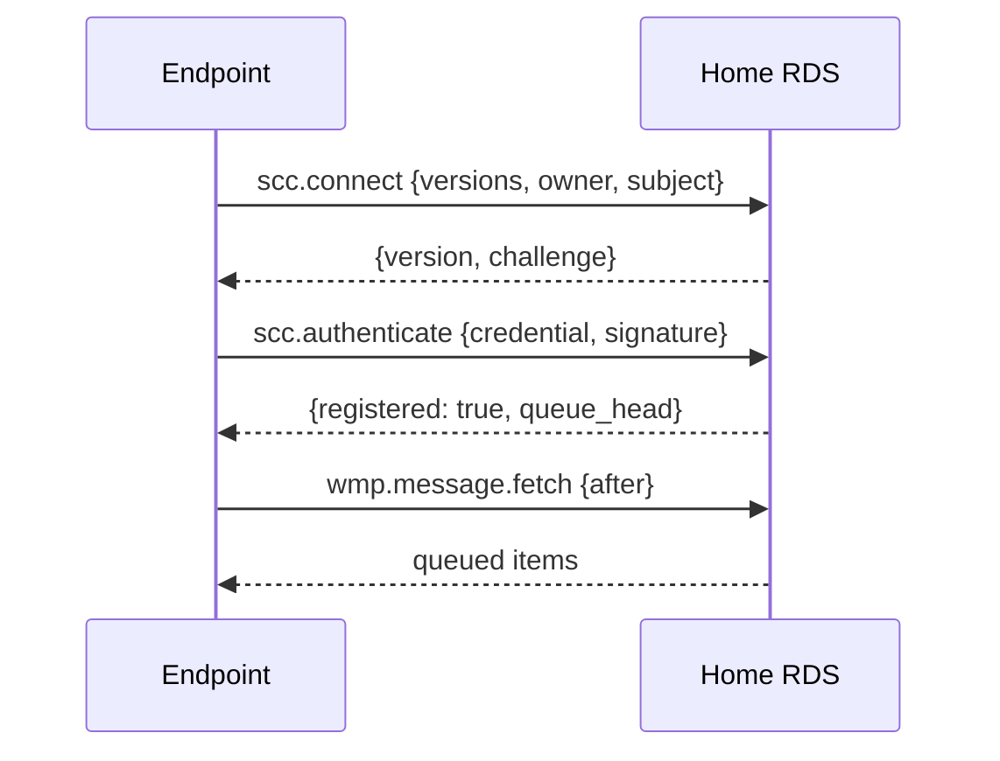
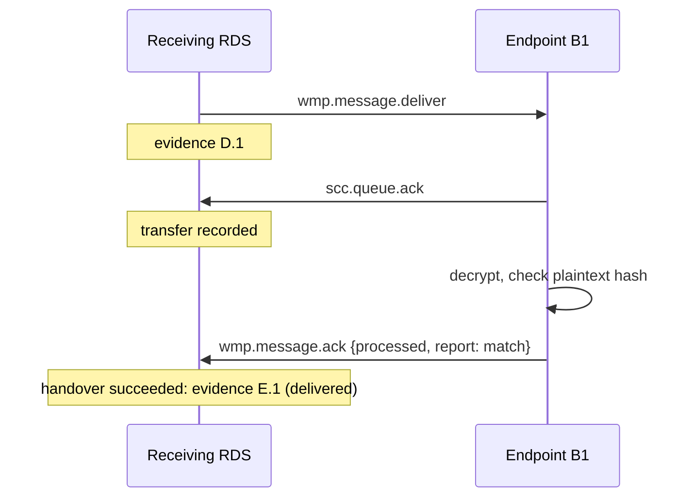
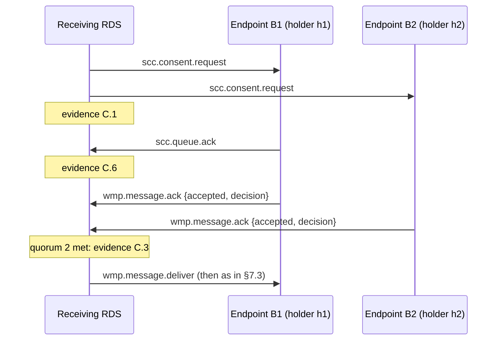
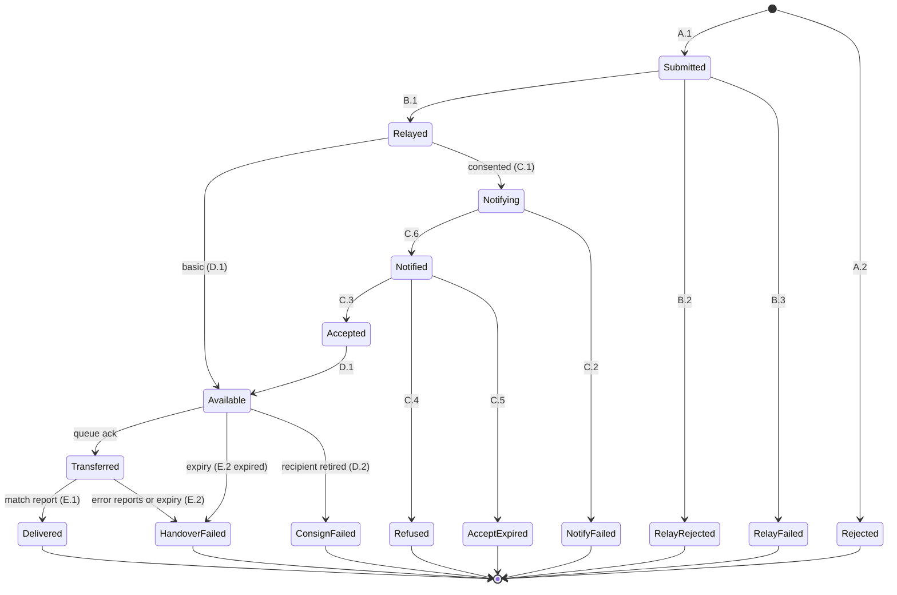

# SCC Delivery

**Element:** Delivery · **Schemas:** [`schemas/delivery.openrpc.json`](schemas/delivery.openrpc.json), [`schemas/rds-metadata.schema.json`](schemas/rds-metadata.schema.json)

## 1. Introduction

This document defines how messages move from a sending endpoint to its
RDS, from that RDS to the recipient's RDS, and from there to the
recipient's endpoints. It also carries the KeyPackage, session and Commit
operations of doc 3, and the evidence of doc 5.

The protocol is a profile of the Wallet Messaging Protocol (WMP). It uses
WMP's JSON-RPC 2.0 envelope, its method names where the meaning is the
same, its WebSocket binding, and its consignment model. It removes what
SCC does not need and adds methods for the SCC-specific parts.

| From WMP | In SCC |
|---|---|
| JSON-RPC 2.0 envelope | Kept |
| WebSocket binding | Kept for endpoint ↔ RDS |
| HTTPS binding | Kept for RDS ↔ RDS |
| `wmp.message.deliver`, `wmp.message.ack`, `wmp.message.fetch` | Kept, with SCC parameters |
| `wmp.evidence.notify` | Kept, carrying SCC evidence (doc 5) |
| `wmp.session.create` | Kept: creates an SCC session (doc 3 §4.3) |
| Consignment modes | `basic` and `consented` kept; `consented_signed` dropped, since every SCC decision is signed |
| Session-level authentication and resumption | Moved to the connection (§4) |
| `wmp` metadata object in `params` | Dropped. The version is agreed per connection |
| Capability negotiation, flows, MCP, `tls` and `mls-optional` modes, multi-hop relay chains, JCS signatures, DNS discovery | Dropped |
| `wmp.message.status` | Replaced by `wmp.evidence.notify` |

New methods use the `scc.` prefix. Methods used only between RDSes use
`scc.rds.`.

## 2. Conventions

- Every message is a JSON-RPC 2.0 request, response or notification.
- Binary values (MLS messages, COSE objects, hashes, IDs) are base64url
  strings without padding.
- An address is a JSON object `{"owner": "...", "role": "..."}`.
- Times are integers (seconds since the epoch).
- Batches MUST NOT be used.

### 2.1 Errors

SCC uses WMP's error codes where they fit, and adds codes in the range
`-31100` to `-31149`.

| Code | Name | Meaning |
|---|---|---|
| -32600 to -32603 | JSON-RPC | Standard JSON-RPC errors |
| -31002 | Not authorized | The caller may not do this |
| -31004 | MLS error | The MLS message is malformed or invalid |
| -31007 | Rate limited | Too many requests |
| -31014 | Queue full | The recipient's queue is full |
| -31016 | Consignment mode unsupported | The receiving RDS does not support the mode |
| -31100 | Membership mismatch | The session is not correctly formed (doc 3 §5). `data` has `add` and `remove` |
| -31101 | Stale epoch | The message or Commit is not for the current epoch. `data` has `epoch` |
| -31102 | Commit conflict | Another Commit for this epoch won |
| -31103 | Unknown session | No such session |
| -31104 | Session closed | The session is closed |
| -31105 | No KeyPackage | An eligible endpoint has no KeyPackage, so the message is not delivered (doc 3 §5.1). `data` has `subjects` and the evidence |
| -31106 | Invalid credential | A credential failed verification (doc 2 §3) |
| -31107 | Duplicate message ID | The message ID was used for a different message |
| -31108 | Bad time | `sent_at` or `expires_at` is out of range |
| -31109 | Owner not active | An EBW owner is suspended, retired, merged or closed. `data` has `owner` and `status` |
| -31110 | Unknown address | The EBW URL does not exist, or the role has no eligible endpoints |
| -31111 | Wrong RDS | The EBW URL is not served by this RDS |
| -31112 | Evidence incomplete | The message has no terminal event yet, or the RDS does not yet hold its whole evidence chain |

When a rejection must be evidenced (§7.1, §7.2), the error `data` carries
the evidence in `evidence`.

## 3. RDS metadata

Each RDS publishes a JSON document at its **RDS URL**, the `rds` URL in
its owners' registry documents. The RDS URL identifies the RDS. It
corresponds to the capability lookup of the EN 319 522 Common Service
Interface. It is modelled on WMP's `/.well-known/wmp-configuration` and
its `erds` object.

```json
{
  "governing_body": {"name": "Example Provider SE", "identifier": "urn:ebw:euid:DEHRB.HRB999999"},
  "trust_domains": ["eu-qualified"],
  "versions": ["scc/1"],
  "endpoints": {
    "client": "wss://rds.example-provider.eu/scc",
    "federation": "https://rds.example-provider.eu/scc/federation"
  },
  "cipher_suites": [1, 2],
  "consignment_modes": ["basic", "consented"],
  "max_message_size": 26214400,
  "max_ttl": 2592000,
  "session_idle_limit": 31536000,
  "max_clock_skew": 300,
  "expiry": true,
  "scheduled_delivery": false,
  "assurance": {
    "identity": ["http://eidas.europa.eu/LoA/high"],
    "authentication": ["http://eidas.europa.eu/LoA/substantial", "http://eidas.europa.eu/LoA/high"]
  },
  "evidence": {
    "policies": ["https://rds.example-provider.eu/policy/erds-2026"],
    "retention": "P10Y",
    "seal_certificates": [["MIIC...", "MIID..."]]
  }
}
```

| Field | Meaning |
|---|---|
| `governing_body` | The legal person operating the RDS: name and identifier. |
| `trust_domains` | Trust domains the RDS belongs to. `eu-qualified` means it is a qualified ERDS on the EU Trusted Lists. |
| `versions` | Supported protocol versions. |
| `endpoints.client` | WebSocket URL for endpoints. |
| `endpoints.federation` | HTTPS URL for other RDSes. |
| `cipher_suites` | MLS cipher suites accepted. |
| `consignment_modes` | Consignment modes supported as receiving RDS. |
| `max_message_size` | Largest MLSMessage accepted, in bytes. |
| `max_ttl` | Longest `expires_at - sent_at` accepted, in seconds. |
| `session_idle_limit` | Idle time after which sessions may be closed, in seconds. |
| `max_clock_skew` | Largest difference between `sent_at` and the RDS's clock that it accepts, in seconds. |
| `expiry` | Support for expiry (`expires_at`). Always `true`. |
| `scheduled_delivery` | Support for scheduled delivery. Always `false` in this version. |
| `assurance` | Levels of assurance (URIs) the RDS supports for identifying its owners and authenticating their endpoints. |
| `evidence.policies` | Evidence policy identifiers (EN 319 522-2 component R01). |
| `evidence.retention` | Evidence retention period (ISO 8601 duration). |
| `evidence.seal_certificates` | Certificate chains of the evidence seal keys. |

The fields cover the ERDS capability metadata required by EN 319 522-2
clause 9.4.4 (Table 14). The JSON Schema is
[`schemas/rds-metadata.schema.json`](schemas/rds-metadata.schema.json).
The document SHOULD be cacheable for up to one day.

## 4. Connections

The connections carry the interfaces of EN 319 522-1 clause 5:

| EN 319 522 interface | SCC |
|---|---|
| ERDS MSI (message submission) | Endpoint to home RDS: `wmp.message.deliver` (§7.1) |
| ERD-UA MEPI (push to user agent) | Home RDS to endpoint: queued notifications (§4.2) |
| ERDS MERI (retrieval) | Endpoint to home RDS: `wmp.message.fetch`, `scc.evidence.get` |
| ERDS RI (relay) | RDS to RDS (§4.3) |
| CSI (routing, trust, capabilities) | The EDD (doc 1), RDS metadata (§3), the EU Trusted Lists |

### 4.1 Endpoint to home RDS

An endpoint connects to `endpoints.client` with WebSocket (RFC 6455) over
TLS 1.3, using subprotocol `scc.v1`. Each text frame holds one JSON-RPC
message. Both sides send requests and notifications.

The endpoint authenticates with two requests:



`signature` is a COSE_Sign1 by the endpoint key over:

```cddl
connect-proof-body = {
  "type": "connect-proof",
  "challenge": bstr,      ; from scc.connect
  "rds": tstr,            ; this RDS's URL
  "owner": ebw-url,
  "subject": subject-id,
  "signed_at": time,
}
```

The RDS checks that:

1. the challenge is one it issued on this connection, has not reached
   the `expires_at` returned with it, and has not been used;
2. the credential is valid (doc 2 §3), with `iss` = `owner` and
   `sub` = `subject`;
3. the signature verifies under the credential's `cnf` key;
4. the registry document for the EBW URL names this RDS (`rds` = this
   RDS's URL).

Until authentication succeeds, the RDS MUST reject every other request
with `-31002`. A connection serves one endpoint.

Example:

```json
{"jsonrpc": "2.0", "id": "c1", "method": "scc.connect",
 "params": {"versions": ["scc/1"], "owner": "ebw:bo6frcnfdr54irr3eybahmh6",
            "subject": "Kq7vT2mXr9Lp"}}

{"jsonrpc": "2.0", "id": "c1",
 "result": {"version": "scc/1", "challenge": "q8Hc3k0W2vY5mTzR1aLx9g",
            "expires_at": 1792310520}}
```

### 4.2 Queue and reconnection

The RDS keeps a queue of items for each endpoint. Every item it sends to
the endpoint is a notification with a `seq` number that increases by one
for each item. The items are:

| Notification | Carries |
|---|---|
| `wmp.message.deliver` | An application message (§7.3) |
| `scc.consent.request` | A request to accept or reject a message (§7.4) |
| `scc.handshake` | A Commit or Welcome (§8) |
| `wmp.evidence.notify` | Evidence (doc 5) |
| `scc.keypackage.status` | KeyPackage pool levels (§6.1) |

The endpoint confirms items with `scc.queue.ack {up_to}`. This removes
every item with `seq <= up_to` from the queue. The RDS MUST keep items
until they are confirmed or expire. Confirming a `wmp.message.deliver`
item is the **transfer** step of the message's handover to that endpoint
(§7.3).

The `queue_head` returned by `scc.authenticate` is the highest `seq` the
RDS has assigned to this endpoint so far, or 0 if none. An endpoint whose
last processed `seq` is lower knows that it has items to fetch.

After a reconnection, the endpoint calls `wmp.message.fetch {after}` with
the last `seq` it processed. The RDS resends later items, in order. No
resumption token is needed: the endpoint simply authenticates again.

### 4.3 RDS to RDS

An RDS calls another RDS by sending one JSON-RPC request in an HTTPS POST
to the peer's `endpoints.federation` URL, with `Content-Type:
application/json`. The response is in the HTTP response body.

Both sides MUST use TLS 1.3 with mutual authentication. Each side MUST:

1. check that the peer's certificate is valid, is for the host of the
   peer's RDS URL, and is qualified (on an EU Trusted List);
2. check that the peer is the home RDS of the EBW URL on whose behalf it
   acts. For example, RDS A may relay a message only from an EBW URL whose
   state names RDS A.

Every federation request is idempotent. A request can be retried with the
same parameters, and gets the same result.

## 5. Endpoint registration

An endpoint is **registered** at its home RDS from its first successful
`scc.authenticate` until:

- its credential expires and it has not presented a newer one;
- its credential is revoked or suspended in its status list (doc 2 §5.3); or
- it calls `scc.deregister`.

Registered endpoints are the ones that count as eligible in the membership
check (doc 3 §4.2). The RDS keeps, for each registered endpoint, its
latest credential, its KeyPackages and its queue.

## 6. KeyPackages

### 6.1 Publishing

`scc.keypackage.publish` uploads KeyPackages (doc 3 §3):

```json
{"jsonrpc": "2.0", "id": "k1", "method": "scc.keypackage.publish",
 "params": {"key_packages": ["AAEAAQ...", "AAEAAQ..."]}}

{"jsonrpc": "2.0", "id": "k1", "result": {"available": {"1": 12, "2": 10}}}
```

The RDS checks each KeyPackage (doc 2 §4.3) and that its credential has
the caller's identity. It rejects last-resort KeyPackages (doc 3 §3). It
sends `scc.keypackage.status` when a pool falls below 5.

### 6.2 Getting KeyPackages

An endpoint gets KeyPackages for an address with `scc.keypackage.get`. If
the address is served by another RDS, its home RDS calls
`scc.rds.keypackage.reserve` on that RDS.

```json
{"jsonrpc": "2.0", "id": "k2", "method": "scc.keypackage.get",
 "params": {"address": {"owner": "ebw:r7jhgo5eukazsq5homclvxdc", "role": "invoices"},
            "cipher_suite": 1}}

{"jsonrpc": "2.0", "id": "k2",
 "result": {"reservation": "Tz0b5sN1cWQe7uJ9", "expires_at": 1792310760,
            "eligible": ["Bx4nW8sYt2Qe", "Hc3pZ6uVj5Rd"],
            "key_packages": [
              {"subject": "Bx4nW8sYt2Qe", "key_package": "AAEAAQ..."},
              {"subject": "Hc3pZ6uVj5Rd", "key_package": "AAEAAQ..."}],
            "missing": []}}
```

The optional `subjects` parameter limits the request to the listed subject
IDs (used after a membership mismatch, doc 3 §5). The result:

| Field | Meaning |
|---|---|
| `reservation` | ID of the reservation holding these KeyPackages |
| `expires_at` | When the reservation ends (§6.3) |
| `eligible` | Subject IDs of all endpoints eligible for the address now |
| `key_packages` | One KeyPackage for each requested eligible endpoint, if available |
| `missing` | Subject IDs of eligible endpoints with no KeyPackage for the cipher suite |

For an address with the caller's own EBW URL, the result leaves out the
caller.

If `missing` is not empty, the sender cannot form a correct session for
the address. A message sent anyway ends in non-delivery (doc 3 §5.1).

### 6.3 Reservations

A KeyPackage handed out is **reserved**, not consumed. The reservation
states when it ends (`expires_at`, chosen by the RDS that holds the
KeyPackage). If a Commit that uses the KeyPackage is accepted before then
(doc 3 §6.3), the KeyPackage is consumed. Otherwise it is released
and can be handed out again. This stops a requester from draining an
endpoint's pool without using it.

A KeyPackage reserved for one requester is not available to others. An
RDS MUST apply per-requester quotas to `scc.rds.keypackage.reserve`.

## 7. Messages

### 7.1 Submission

The sender submits a message with `wmp.message.deliver`:

```json
{"jsonrpc": "2.0", "id": "m1", "method": "wmp.message.deliver",
 "params": {
   "session_id": "XA6aB3x9QkS0vF2r8mJ1Zw",
   "message": "AAEAAgAQXA6a...",
   "meta": {
     "message_id": "AZLxo7bWdsSRiMFmJqsa8g",
     "from": {"owner": "ebw:bo6frcnfdr54irr3eybahmh6", "role": "purchasing"},
     "to": {"owner": "ebw:r7jhgo5eukazsq5homclvxdc", "role": "invoices"},
     "sent_at": 1792310460,
     "expires_at": 1793520060,
     "consignment": "consented"
   },
   "plaintext_hash": "q1y8E0nqVxWm6F5bP8fJ2tR3uYk9zC4hA7sD1gL0oPc",
   "epoch_authenticator": "Yt7rE2wQ9kZb1xV4nM8cJ0sH3uF6gD5aL2pO9iK1mNw"
 }}
```

The sending RDS checks, in order:

1. The caller is a member of the session, on the `from` side.
2. The `MLSMessage` is a `PrivateMessage` with `group_id` = `session_id`
   and `epoch` = the current epoch (else `-31101`).
3. `from` and `to` are the session's two addresses, in that direction.
4. The session is correctly formed (else `-31100`; doc 3 §5).
5. Every eligible endpoint that is missing from the session has a
   KeyPackage available (else `-31105`; doc 3 §5.1).
6. `sent_at` is within the RDS's published `max_clock_skew` (§3) of its
   clock, and
   `sent_at < expires_at <= sent_at + max_ttl`, using the smaller
   `max_ttl` of the two RDSes (else `-31108`).
7. The receiving RDS supports the consignment mode (else `-31016`).
8. Both owners have current `active` head statements (else `-31109`).
9. `message_id` is new. If it was already accepted with the same
   `MLSMessage`, the RDS returns the earlier result. If with a different
   one, it rejects with `-31107`.

Check 5 runs only when check 4 fails, and replaces its error.

Checks 4 and 5 need the receiving RDS's list of eligible endpoints. If
the receiving RDS cannot be reached, and the sending RDS holds no
unexpired answer from it, the sending RDS runs checks 4 and 5 for the
sender's side only, and holds the message for relay. The receiving RDS
checks the recipient's side at relay (§7.2, doc 3 §5).

If all checks pass, the RDS issues **A.1 SubmissionAcceptance** evidence
and returns it:

```json
{"jsonrpc": "2.0", "id": "m1", "result": {"evidence": "hEOhASagWQF..."}}
```

Rejections at checks 5 to 9 are evidenced with **A.2
SubmissionRejection**, returned in the error `data`. Rejections at checks
1 to 4 are protocol errors, which the sender corrects and retries. They
are not evidenced.

The RDS also queues the message for the other members on the sender's
side, so that all of the sender's endpoints see it.

### 7.2 Relay

The sending RDS relays the message to the receiving RDS with
`wmp.message.deliver`, adding the A.1 evidence and the relay time:

```json
{"jsonrpc": "2.0", "id": "r-AZLxo7bWdsSRiMFmJqsa8g", "method": "wmp.message.deliver",
 "params": {
   "session_id": "XA6aB3x9QkS0vF2r8mJ1Zw",
   "message": "AAEAAgAQXA6a...",
   "meta": { "...": "as in §7.1" },
   "plaintext_hash": "q1y8E0nq...",
   "epoch_authenticator": "Yt7rE2wQ...",
   "submission_evidence": "hEOhASagWQF...",
   "relayed_at": 1792310462
 }}
```

The receiving RDS verifies the A.1 evidence, and repeats checks 2 to 9
of §7.1 with its own data, with three differences. Each avoids rejecting,
for good, a message that the sending RDS rightly accepted:

- **Epoch (check 2).** The message's epoch may be the current epoch, or
  an earlier one if A.1's `mls.group_context` is the receiving RDS's own
  GroupContext for the message's epoch. The sending RDS has signed that
  it accepted the message in that epoch, so a Commit accepted while the
  message was in flight does not make it stale. No times are compared.
  Endpoints keep the keys of recent past epochs so that they can decrypt
  such messages.
- **Membership (check 4).** The session is checked as it was in the
  message's epoch. The recipient side's eligible endpoints are those of
  any `scc.rds.subjects` answer the receiving RDS gave that has not
  expired, or its current list. An answer is a commitment for its
  validity period (§9).
- **Time (check 6).** The clock-skew part is skipped, since a relay may be
  retried long after `sent_at`. The receiving RDS checks only that
  `expires_at` has not passed and is within its `max_ttl` of `sent_at`.

If the checks pass, the receiving RDS issues **B.1 RelayAcceptance** and
returns it. If a check fails, it issues **B.2 RelayRejection** and returns
it in the error `data`.

If the sending RDS cannot get an answer before `expires_at`, it issues
**B.3 RelayFailure**. It SHOULD retry with backoff until then.

When both owners use the same RDS, there is no relay and no B events.

The relay request is the ERD message of EN 319 522. Its parts map to the
relay metadata of EN 319 522-2 clause 6:

| Component | SCC |
|---|---|
| MD01 Metadata version | The protocol version agreed for the connection |
| MD02 Relay date and time | `relayed_at` |
| MD03 Expiry date and time | `meta.expires_at` |
| MD04 Recipient required level of assurance | Not used; set by RDS policy |
| MD05 Applicable policy | Not used |
| MD06 Mode of consignment | `meta.consignment` |
| MD07 Scheduled delivery | Not supported |
| MD08 Sender's identifier | `meta.from` |
| MD09 Reply-to | Not used; replies go to `from` |
| MD10 Recipient's identifier | `meta.to` |
| MD11 Message identifier | `meta.message_id`. EN 319 522-2 has the S-ERDS generate it. In SCC the sending endpoint chooses it (16 random bytes), and the sending RDS checks that it is new (§7.1 check 9). |
| MD12 In reply to | Inside the ciphertext only (`in_reply_to`, doc 3 §7.1) |
| MD13 Message type | Implied by the method |
| MD14 User content information | `plaintext_hash`, the `MLSMessage` size, and the envelope hash in A.1 |

EN 319 522-2 clause 7.1 requires every ERD message to be signed by the
relaying ERDS. The A.1 evidence in `submission_evidence` is the sending
RDS's signature over the message: it binds every metadata field above and
the hash of the exact `MLSMessage`.

### 7.3 Consignment and handover

Once a message may be made available to the recipient (in `basic` mode
after B.1, in `consented` mode after C.3), the receiving RDS queues it for
every member endpoint on the recipient's side, as a `wmp.message.deliver`
notification, and issues **D.1 ContentConsignment**:

```json
{"jsonrpc": "2.0", "method": "wmp.message.deliver",
 "params": {"seq": 418, "session_id": "XA6aB3x9...", "message": "AAEAAgAQ...",
            "meta": { "...": "as in §7.1" }, "plaintext_hash": "q1y8E0nq...",
            "epoch_authenticator": "Yt7rE2wQ..."}}
```

The notification carries the sender's epoch authenticator. A recipient
endpoint compares it with its own. Equal values tell it that it agrees with the
sender on the group state, which ends its retention duty (doc 5 §8).
Different values make it report `invalid-epoch` (doc 5 §4).

Each recipient endpoint then attempts a **handover**: the message
crosses from the receiving RDS to the endpoint, which shows that it can
read it. A handover has two steps, and the receiving RDS records each
with the endpoint and the time:

1. **Transfer.** The endpoint confirms the item with `scc.queue.ack`. The
   ciphertext has now crossed to the endpoint.
2. **Acknowledgement.** The endpoint decrypts the message and sends its
   decryption report (§7.5). It MUST do so at once after the transfer.

A handover **succeeds** when an endpoint holding the `to` role sends a
`match` report. It fails if the endpoint reports any other result, or
never reports.

The receiving RDS ends the message with exactly one outcome:

| Outcome | Evidence | When |
|---|---|---|
| **Delivered** | E.1 ContentHandover | The first handover succeeds. The evidence embeds the `match` report. |
| **Decryption failed** | E.2 ContentHandoverFailure, reason `decryption-failed` | Every member endpoint on the recipient's side has reported and none reported a match; or `expires_at` passes after at least one error report and no match. The evidence embeds the reports. |
| **Not acknowledged** | E.2 ContentHandoverFailure, reason `not-acknowledged` | `expires_at` passes after at least one transfer, with no report at all. |
| **Not transferred** | E.2 ContentHandoverFailure, reason `expired` | `expires_at` passes with no transfer. |

Only E.1 means the message was delivered. There is no separate timer:
the recipient has until `expires_at` to complete a handover. E.1 and E.2
list every handover attempt in `handovers`, with its steps and result.

D.1 is not a final outcome. D-class events end a message only when
consignment itself fails fatally: D.2 ContentConsignmentFailure when the
recipient is retired, merged or closed (§7.8).



### 7.4 Consented consignment

In `consented` mode, the recipient's endpoints must accept the message
before it is made available.



1. The receiving RDS queues an `scc.consent.request` for every member
   endpoint on the recipient's side, and issues **C.1
   NotificationForAcceptance**. The request carries the metadata, the
   `envelope_hash` and the size of the message, but not the message.
2. When an endpoint first confirms a consent request with
   `scc.queue.ack`, the RDS issues **C.6 NotificationDelivered**. A
   consent decision also shows that the request was delivered: if one
   arrives before any confirmation, the RDS issues C.6 first, and then
   handles the decision.
3. Each endpoint MAY answer with `wmp.message.ack`, status `accepted` or
   `rejected`, and a **consent decision** signed by its endpoint key (doc
   5 §6).
4. The receiving RDS evaluates the recipient's acceptance policy for the
   `to` role (doc 1 §3.2), using the registry document named in the B.1
   evidence:
   - It counts distinct holders among endpoints that accepted and hold the
     role.
   - For `"all"`, the required holders are those of endpoints eligible
     when B.1 was issued.
5. When the policy is met, the RDS issues **C.3 ConsignmentAcceptance**,
   listing the decisions. It then makes the message available (§7.3).
6. The first `rejected` decision from an endpoint holding the role ends
   the message. The RDS issues **C.4 ConsignmentRejection**.
7. If no endpoint has confirmed a consent request by `expires_at`, the RDS
   issues **C.2 NotificationForAcceptanceFailure**. If one has, but the
   policy is not met by `expires_at`, it issues **C.5
   AcceptanceRejectionExpiry**.

### 7.5 Decryption reports

After a message is transferred to it, each recipient endpoint MUST try to
decrypt it and MUST send a decryption report (doc 5 §4) with
`wmp.message.ack` at once, without waiting for user action. If it must
first catch up on Commits (`scc.commit.fetch`), it does so and then
reports.

```json
{"jsonrpc": "2.0", "id": "a7", "method": "wmp.message.ack",
 "params": {"message_id": "AZLxo7bWdsSRiMFmJqsa8g", "status": "processed",
            "report": "0oRDoQEmoFkB..."}}
```

| Status | Report result |
|---|---|
| `processed` | `match` |
| `failed` | `mismatch`, `decrypt-failed`, `invalid-epoch` or `join-failure` |

The receiving RDS verifies the report's signature and credential, and
checks that the endpoint was a member of the session at the message's
epoch. It uses reports to decide between E.1 and E.2 (§7.3). It stores
every report. Reports that arrive after the final outcome are stored but
change nothing.

An endpoint that could not join the session with its Welcome reports
`join-failure`. One that could not process a Commit, and so does not hold
the message's epoch, reports `invalid-epoch` with `held_epoch`.

### 7.6 Mapping to ETSI EN 319 522-1 events

EN 319 522-1 clause 6.2.1 leaves it to each service to say which event
means successful delivery. In SCC it is **E.1 ContentHandover**: the
message has crossed to an authenticated recipient endpoint, which has
decrypted it and confirmed the plaintext hash.

| Event | Used | When |
|---|---|---|
| A.1, A.2 | Yes | Submission accepted or rejected (§7.1) |
| B.1, B.2, B.3 | Yes | Relay accepted, rejected or failed (§7.2) |
| C.1, C.2, C.3, C.4, C.5, C.6 | In `consented` mode | §7.4 |
| D.1 | Yes | Message made available to the recipient's endpoints (§7.3). Not final. |
| D.2 | Yes | Consignment failed fatally: recipient retired, merged or closed (§7.8) |
| D.3, D.4, D.5 | No | SCC has no separate notification channel |
| D.6 | No | Access is part of the handover (E.1); EN 319 522-1 Table 1 note 4 says E.1 and D.6 should not both be present |
| E.1 | Yes | Successful handover: delivered (§7.3) |
| E.2 | Yes | Failed handover: decryption failed, not acknowledged, or not transferred (§7.3) |
| F.1, F.2, F.3 | No | SCC has no gateways to other systems |

### 7.7 Evidence to the sender

The receiving RDS sends each piece of evidence it issues (B.x, C.x, D.x)
to the sending RDS with `wmp.evidence.notify`. The sending RDS stores it
and queues it, with its own evidence, for the sender's endpoints:

```json
{"jsonrpc": "2.0", "method": "wmp.evidence.notify",
 "params": {"seq": 77, "message_id": "AZLxo7bWdsSRiMFmJqsa8g",
            "event": "E.1", "evidence": "hEOhASagWQF..."}}
```

The `event` parameter is the event's short code. The evidence itself
carries the full ETSI event URI (doc 5 §3.3).

Either side's endpoints can get the full evidence package with
`scc.evidence.get` (doc 5 §3.6). Evidence notifications can arrive out of
order, so an RDS composes a package only once it holds the whole chain,
from A.1 to the terminal event. Until then, `scc.evidence.get` returns
`-31112` (evidence incomplete).

### 7.8 Outcomes and holds

Every accepted message ends in exactly one **final outcome**:



With a single RDS, the Submitted state goes straight to Available or
Notifying.

If the recipient becomes `suspended`, the receiving RDS **holds** the
message: it stops delivering and issuing evidence, but keeps the message.
If the suspension ends before `expires_at`, delivery resumes. Otherwise
the message expires (C.2, C.5 or E.2). If the recipient becomes `retired`,
`merged` or `closed`, the receiving RDS ends the message with D.2 and
the matching reason.

## 8. Sessions and Commits

### 8.1 Creating a session

`wmp.session.create` registers a new session and its first Commit (doc 3
§4.3):

```json
{"jsonrpc": "2.0", "id": "s1", "method": "wmp.session.create",
 "params": {"session_id": "XA6aB3x9QkS0vF2r8mJ1Zw",
            "group_info": "AAEABAAQXA6a...",
            "commit": "AAEAAQAQXA6a...",
            "welcome": "AAEAAwAB...",
            "reservations": ["Tz0b5sN1cWQe7uJ9"]}}

{"jsonrpc": "2.0", "id": "s1", "result": {"epoch": 1}}
```

The home RDS checks the GroupInfo (doc 3 §4.1, §6.2), registers the
session with the peer RDS (`scc.rds.session.create`), and then processes
the Commit as in §8.2.

### 8.2 Submitting a Commit

`scc.commit.submit` submits a Commit (and its Welcome, if it adds
members). The home RDS runs the two-sided acceptance of doc 3 §6.3 with
`scc.rds.commit`.

```json
{"jsonrpc": "2.0", "id": "s2", "method": "scc.commit.submit",
 "params": {"session_id": "XA6aB3x9QkS0vF2r8mJ1Zw",
            "commit": "AAEAAQAQXA6a...",
            "welcome": "AAEAAwAB...",
            "reservations": ["Hn4cQ0rP2wLs8yVb"]}}

{"jsonrpc": "2.0", "id": "s2", "result": {"epoch": 6}}
```

### 8.3 Distributing handshake messages

When a Commit is accepted, each RDS queues an `scc.handshake` notification
for each of its own member endpoints, except the committer. New members
get the Welcome instead.

```json
{"jsonrpc": "2.0", "method": "scc.handshake",
 "params": {"seq": 419, "session_id": "XA6aB3x9QkS0vF2r8mJ1Zw",
            "epoch": 6, "commit": "AAEAAQAQXA6a..."}}
```

### 8.4 Catching up

`scc.commit.fetch {session_id, after_epoch}` returns the accepted Commits
after `after_epoch`. `scc.session.log {session_id}` returns the whole log:
the creation GroupInfo and every Commit with its acceptance time. Endpoints
use it to build evidence bundles (doc 5 §7).

### 8.5 Reporting a bad Commit

`scc.commit.report {session_id, epoch, report}` tells the home RDS that
the endpoint could not process an accepted Commit (doc 3 §6.5). `report`
is a commit failure report signed by the endpoint key (doc 5 §5). The RDS
issues **commit failure evidence** (doc 5 §3.4) and returns it, tells the peer with
`scc.rds.commit.report`, and closes the session.

## 9. Federation methods

| Method | Called by | Purpose |
|---|---|---|
| `scc.rds.subjects` | Either RDS | List the subject IDs eligible for an address (doc 3 §5) |
| `scc.rds.keypackage.reserve` | Sending side | Reserve KeyPackages (§6.2) |
| `scc.rds.session.create` | Creator's RDS | Register a session (§8.1) |
| `scc.rds.commit` | Submitting RDS | Two-sided Commit acceptance (doc 3 §6.3) |
| `scc.rds.commit.report` | Either RDS | Report a bad Commit and close the session (§8.5) |
| `wmp.message.deliver` | Sending RDS | Relay a message (§7.2) |
| `wmp.evidence.notify` | Receiving RDS | Send evidence to the sending RDS (§7.7) |

`scc.rds.subjects` lists the subject IDs of the endpoints eligible for
an address, and which of them have no KeyPackage for the given cipher
suite (doc 3 §5). `cipher_suite` is required. The answer is valid until
its `expires_at`. Until then the answering RDS MUST accept, at relay, a
session whose members match the answer (§7.2), even if an endpoint has
since registered or been revoked. The answering RDS chooses the period.

```json
{"jsonrpc": "2.0", "id": "f1", "method": "scc.rds.subjects",
 "params": {"address": {"owner": "ebw:r7jhgo5eukazsq5homclvxdc", "role": "invoices"},
            "cipher_suite": 1}}

{"jsonrpc": "2.0", "id": "f1",
 "result": {"as_of": 1792310455,
            "expires_at": 1792310515,
            "subjects": ["Bx4nW8sYt2Qe", "Hc3pZ6uVj5Rd", "Mf8kD1yGn7Ta"],
            "no_key_packages": []}}
```

## 10. Method summary

Endpoint to home RDS:

| Method | Type | Section |
|---|---|---|
| `scc.connect` | request | §4.1 |
| `scc.authenticate` | request | §4.1 |
| `scc.deregister` | request | §5 |
| `scc.queue.ack` | request | §4.2 |
| `wmp.message.fetch` | request | §4.2 |
| `scc.keypackage.publish` | request | §6.1 |
| `scc.keypackage.get` | request | §6.2 |
| `wmp.session.create` | request | §8.1 |
| `scc.commit.submit` | request | §8.2 |
| `scc.commit.fetch` | request | §8.4 |
| `scc.session.log` | request | §8.4 |
| `scc.commit.report` | request | §8.5 |
| `wmp.message.deliver` | request | §7.1 |
| `wmp.message.ack` | request | §7.4, §7.5 |
| `scc.evidence.get` | request | §7.7 |

Home RDS to endpoint (queued notifications, §4.2): `wmp.message.deliver`,
`scc.consent.request`, `scc.handshake`, `wmp.evidence.notify`,
`scc.keypackage.status`.

The parameters and results of every method are defined in
[`schemas/delivery.openrpc.json`](schemas/delivery.openrpc.json).

## 11. Security considerations

- **Authorization.** An RDS acts only for EBW URLs whose state names it. A
  federation peer that asks about, or relays for, an EBW URL it does not serve
  is rejected with `-31111`.
- **Metadata.** RDSes see who talks to whom, when, and how much. Padding
  (doc 3 §7.1) hides exact sizes.
- **Queue integrity.** An RDS could drop a message rather than deliver
  it. The sender then gets no E.1 or C.3 evidence, so the failure is
  visible.
- **KeyPackage exhaustion.** Reservations and quotas limit the damage a
  requester can do. An endpoint whose pool is drained causes evidenced
  non-delivery (doc 3 §5.1), not silent loss.
- **Replay.** Message IDs and Commit references make every operation
  idempotent. MLS rejects replayed application messages at the endpoint.
