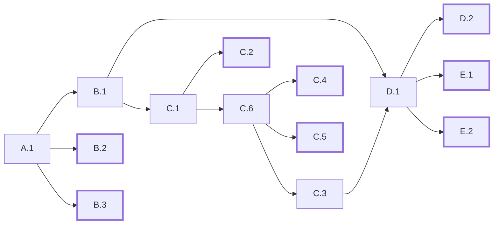
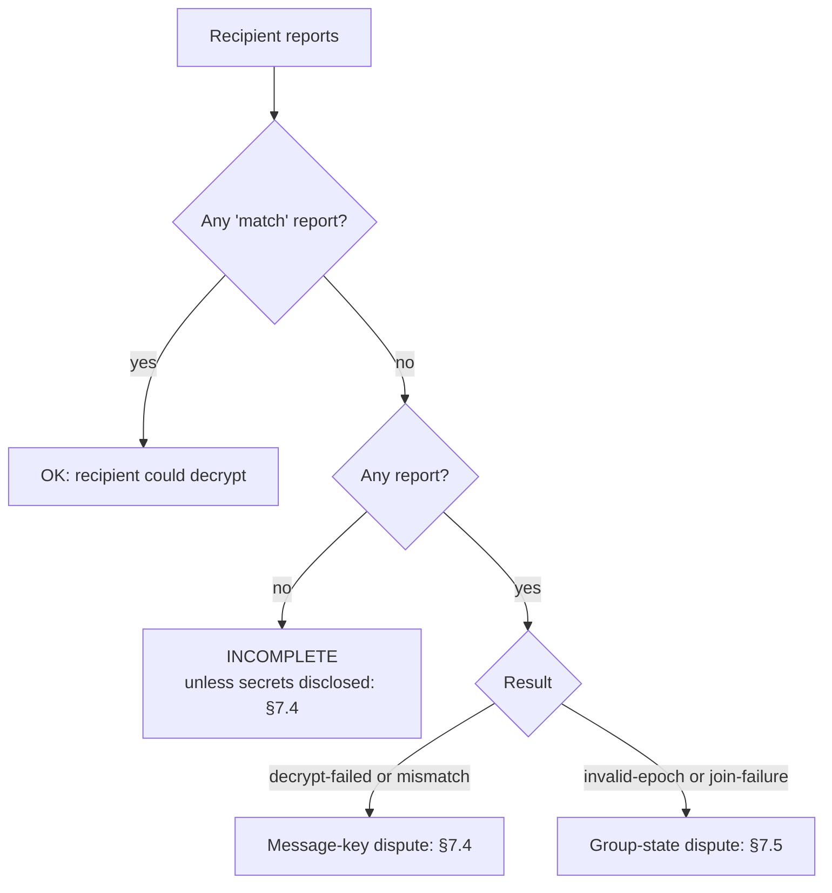

# SCC Evidence

**Element:** Evidence · **Schema:** [`schemas/evidence.cddl`](schemas/evidence.cddl)

## 1. Introduction

RDSes issue evidence of what happens to each message: submission, relay,
consent, handover, and their failures. Endpoints contribute signed
statements about what they did with a message: decryption reports and
consent decisions. Together these let a verifier answer, years later:

1. Was a message sent, relayed, accepted and handed over, and when?
2. What plaintext did the sender commit to?
3. Could the recipient decrypt it?

RDSes never see plaintext. Evidence binds to messages through three
values:

| Value | Defined in | Binds evidence to |
|---|---|---|
| `envelope_hash` | §3.2 | The exact ciphertext (MLSMessage) |
| `plaintext_hash` | doc 3 §7.2 | The plaintext, through a salted hash |
| `group_context` | doc 3 §6.2 | The MLS state, through the Commit log |

The **epoch authenticator** reported by each endpoint (doc 3 §8) shows
whether sender and recipient agree on that state. It also says what is
needed to settle a dispute (§7).

## 2. Evidence artefacts

### 2.1 Structure

An evidence artefact is a COSE_Sign1 and a timestamp over it:

```cddl
evidence-artefact = [
  seal: bstr .cbor evidence-seal,
  timestamp: bstr,   ; RFC 3161 TimeStampToken
]

; COSE_Sign1 over an evidence body
evidence-seal = [cose-protected, cose-unprotected, payload: bstr .cbor evidence-body, cose-signature]
```

The issuing RDS:

1. encodes the evidence body with deterministic CBOR;
2. signs it as a COSE_Sign1 with its evidence seal key;
3. gets a qualified timestamp whose message imprint is SHA-256 of the
   encoded COSE_Sign1.

The protected header of the COSE_Sign1 MUST contain `alg` and `x5chain`
(label 33). The chain MUST lead to a qualified certificate for
electronic seals (QSealC) issued to the RDS provider.

EN 319 522-2 clause 7.2 recommends CAdES, XAdES or PAdES signatures with
a signature timestamp (level B-T). SCC uses COSE instead, to match the
CBOR encoding used throughout. The construction gives the same
properties: a seal over the evidence and a qualified timestamp over the
seal.

### 2.2 Verification

A verifier:

1. Decodes the artefact and the COSE_Sign1. The payload MUST be
   deterministically encoded.
2. Verifies the signature with the leaf certificate in `x5chain`.
3. Checks that the certificate chain was valid and qualified at the
   timestamp's time, using the EU Trusted Lists.
4. Verifies the timestamp and checks that its imprint is SHA-256 of the
   COSE_Sign1.
5. Validates the body against the CDDL.
6. Verifies each embedded head statement (doc 1 §5.2) and checks that it
   was unexpired at `event_time`.
7. Verifies each embedded endpoint statement (§4, §5, §6), including
   its credential (doc 2 §3). For the credential's status it uses the
   embedded status list token, checking that the token's signature,
   `iat` and `exp` cover the time of the statement.

## 3. Evidence bodies

### 3.1 Message evidence

Every ETSI event uses this body:

```cddl
message-evidence = {
  "v": 1,
  "evidence_id": evidence-id,
  "event": message-event,
  "issuer": issuer,
  "event_time": time,
  "message": message-ref,
  ? "mls": mls-ref,
  ? "reason": reason,
  "heads": [* bstr .cbor head-statement],   ; head statements relied on
  ? "statuses": [+ bstr .cbor status-list-token],   ; status lists relied on
  "sender_assurance": assurance,
  ? "recipient_assurance": assurance,
  ? "peer": tstr,                 ; RDS URL of the other RDS (B events)
  ? "prev": [+ hash32],           ; evidence this follows (§3.7)
  ? "endpoint": endpoint-ref,     ; see the event table
  ? "handovers": [+ handover],    ; E.1, E.2
  ? "decisions": [+ bstr .cbor signed-consent-decision],  ; C.3, C.4
  ? "reports": [+ bstr .cbor signed-decryption-report],   ; E.1, E.2
  ? "eligible_holders": uint,     ; C.1: holders that could accept
}

issuer = {
  "rds": tstr,                    ; RDS URL
  "name": tstr,                   ; legal name of the RDS provider
  "policies": [+ tstr],           ; evidence policy identifiers (URIs)
}

message-ref = {
  "message_id": message-id,
  "session_id": session-id,
  "from": address,
  "to": address,
  "sent_at": time,
  "expires_at": time,
  "consignment": consignment-mode,
  "plaintext_hash": hash32,
  "envelope_hash": hash32,
}

mls-ref = {
  "group_context": bstr,          ; TLS-encoded GroupContext of the message's epoch
  "epoch_authenticator": bstr,    ; as reported by the sender
}

assurance = {
  "identity": {
    "level": tstr,                ; URI, e.g. "http://eidas.europa.eu/LoA/high"
    ? "policy": tstr,             ; URI of the identification policy
  },
  "authentication": {
    "level": tstr,                ; URI
    ? "method": tstr,             ; URI of the authentication method
    ? "at": time,                 ; when the authentication took place
  },
}

endpoint-ref = {
  "owner": ebw-url,
  "subject": subject-id,
}

handover = {
  "subject": subject-id,
  "transferred_at": time,
  ? "acknowledged_at": time,      ; when the decryption report arrived
  ? "result": report-result,      ; the report's result
}
```

### 3.2 Field rules

- `message` is the same in every artefact for one message. The verifier
  MUST check this.
- `envelope_hash` is SHA-256 of the encoded `MLSMessage`. Every RDS
  computes it from the bytes it handled.
- `mls.group_context` is taken from the issuing RDS's **own** Commit log,
  for the session and the epoch in the `PrivateMessage` header. It is
  never copied from the sender. `mls` is absent only if the session is
  unknown to the issuer.
- `mls.epoch_authenticator` is the value the sender gave at submission
  (doc 4 §7.1).
- `heads` holds the head statements of both owners that the issuer relied
  on (doc 1 §5.2). For A.2 and B.2 caused by an owner's status, it holds
  the head statement showing that status.
- `statuses` holds the status list tokens (doc 2 §5.3) that the issuer
  checked for the credentials of every endpoint the evidence names: the
  endpoint in `endpoint`, and the endpoints whose decisions or reports it
  embeds. Each token must have been current at `event_time`.
- `sender_assurance` describes how the sender was identified (its
  registration with the EDD) and authenticated (the connection proof of
  its endpoint, doc 4 §4.1). It is copied from A.1 into later evidence.
- `recipient_assurance` does the same for the recipient endpoint that
  acted. It is REQUIRED in C.3, C.4 and E.1.
- Evidence does not carry the credential of the endpoint in `endpoint`.
  That credential is in the endpoint's leaf of the session's ratchet tree,
  which the GroupContext binds through its tree hash. A verifier rebuilds
  the tree from the session log and finds the leaf by its subject ID.
- `peer` is REQUIRED in B events. It names the other RDS.
- `prev` links the evidence into a chain (§3.7). It is absent only in
  A.1 and A.2.
- `handovers` lists every handover attempt (doc 4 §7.3): the endpoint,
  when the message was transferred to it, and, if it reported, when and
  with what result.
- `reports` holds, in E.1, the `match` report that completed the handover
  and, in E.2, the error reports received.

### 3.3 Events

The `event` field holds the event identifier URI of EN 319 522-3. The
short codes are used in this document and in the delivery protocol.

```cddl
message-event = "http://uri.etsi.org/19522/Event/SubmissionAcceptance"          ; A.1
              / "http://uri.etsi.org/19522/Event/SubmissionRejection"           ; A.2
              / "http://uri.etsi.org/19522/Event/RelayAcceptance"               ; B.1
              / "http://uri.etsi.org/19522/Event/RelayRejection"                ; B.2
              / "http://uri.etsi.org/19522/Event/RelayFailure"                  ; B.3
              / "http://uri.etsi.org/19522/Event/NotificationForAcceptance"     ; C.1
              / "http://uri.etsi.org/19522/Event/NotificationForAcceptanceFailure" ; C.2
              / "http://uri.etsi.org/19522/Event/ConsignmentAcceptance"         ; C.3
              / "http://uri.etsi.org/19522/Event/ConsignmentRejection"          ; C.4
              / "http://uri.etsi.org/19522/Event/AcceptanceRejectionExpiry"     ; C.5
              / "http://uri.etsi.org/19522/Event/NotificationDelivered"         ; C.6
              / "http://uri.etsi.org/19522/Event/ContentConsignment"            ; D.1
              / "http://uri.etsi.org/19522/Event/ContentConsignmentFailure"     ; D.2
              / "http://uri.etsi.org/19522/Event/ContentHandover"               ; E.1
              / "http://uri.etsi.org/19522/Event/ContentHandoverFailure"        ; E.2
```

| Event | Name | Issuer | `endpoint` | Extra fields |
|---|---|---|---|---|
| A.1 | SubmissionAcceptance | Sending RDS | Sender | — |
| A.2 | SubmissionRejection | Sending RDS | Sender | `reason` |
| B.1 | RelayAcceptance | Receiving RDS | — | `peer` |
| B.2 | RelayRejection | Receiving RDS | — | `peer`, `reason` |
| B.3 | RelayFailure | Sending RDS | — | `peer`, `reason` |
| C.1 | NotificationForAcceptance | Receiving RDS | — | `eligible_holders` |
| C.2 | NotificationForAcceptanceFailure | Receiving RDS | — | `reason` |
| C.3 | ConsignmentAcceptance | Receiving RDS | — | `decisions`, `recipient_assurance` |
| C.4 | ConsignmentRejection | Receiving RDS | Refusing endpoint | `decisions`, `reason`, `recipient_assurance` |
| C.5 | AcceptanceRejectionExpiry | Receiving RDS | — | `reason` |
| C.6 | NotificationDelivered | Receiving RDS | First endpoint to confirm | — |
| D.1 | ContentConsignment | Receiving RDS | — | — |
| D.2 | ContentConsignmentFailure | Receiving RDS | — | `reason` |
| E.1 | ContentHandover | Receiving RDS | Endpoint whose handover succeeded | `handovers`, `reports`, `recipient_assurance` |
| E.2 | ContentHandoverFailure | Receiving RDS | — | `reason`, `handovers`, `reports` |

Doc 4 §7.3 and §7.6 say when each event occurs. E.1 is successful
delivery. E.2 is a failed handover, with the reason saying how it failed.
D.1 is not final, and D.2 is used only when consignment fails fatally. When sender and recipient share one RDS, that
RDS issues every event and B events do not occur.

### 3.4 Commit failure evidence

When an endpoint reports a Commit it cannot process (doc 3 §6.5), its
home RDS records the report in **commit failure evidence**. This is SCC
session evidence, not ERDS evidence: it concerns a session, not a message,
and has no EN 319 522 event. It uses the same artefact format.

```cddl
commit-failure-evidence = {
  "v": 1,
  "evidence_id": evidence-id,
  "event": "urn:ebw:scc:event:CommitFailure",
  "issuer": issuer,
  "event_time": time,
  "session_id": session-id,
  "commit_ref": hash32,     ; SHA-256 of the Commit's MLSMessage
  "group_context": bstr,    ; GroupContext after the Commit, from the issuer's log
  "report": bstr .cbor signed-commit-failure-report,    ; §5
}
```

### 3.5 Reasons

The reason code is an EN 319 522-2 reason identifier (clause 8.3.3). SCC
adds its own, more specific reason in `scc`.

```cddl
reason = {
  "code": etsi-reason-code,
  ? "scc": scc-reason,
  ? "text": tstr,
}

etsi-reason-code = tstr .regexp "R[A-F]([0-9]{2}|XX)"
```

| SCC reason | Events | Meaning | EN 319 522-2 code |
|---|---|---|---|
| `malformed` | A.2, B.2 | Message or metadata malformed | RA02 (A.2), RB02 (B.2) |
| `bad-time` | A.2, B.2 | `sent_at` or `expires_at` out of range | RA05, RB06 |
| `duplicate-message-id` | A.2 | Message ID reused for another message | RA05 |
| `consignment-unsupported` | A.2, B.2 | Mode not supported | RA05, RB06 |
| `sender-not-active` | A.2, B.2 | Sender suspended, retired, merged or closed | RA05, RB06 |
| `recipient-not-active` | A.2, B.2 | Recipient suspended | RA05, RB06 |
| `recipient-retired` | A.2, B.2, D.2 | Recipient retired or closed | RA05, RB21, RD21 |
| `recipient-merged` | A.2, B.2, D.2 | Recipient merged; see successor in head statement | RA05, RB21, RD21 |
| `unknown-address` | A.2, B.2 | No such EBW URL, or no eligible endpoint for the role | RA05, RB21 |
| `no-keypackage` | A.2, B.2 | An eligible endpoint has no KeyPackage (doc 3 §5.1) | RA05, RB06 |
| `membership-mismatch` | B.2 | Session not correctly formed at the receiving RDS | RB06 |
| `rds-unreachable` | B.3 | Receiving RDS not reached before expiry | RB09 |
| `rds-not-identified` | B.3 | Receiving RDS could not be identified | RB08 |
| `notification-failed` | C.2 | No consent request confirmed before expiry | RC05 |
| `refused` | C.4 | A recipient endpoint refused the message | RC08 |
| `expired` | C.5 | Notified, but the policy was not met before expiry | RC09 |
| `decryption-failed` | E.2 | Transferred; endpoints reported, but none reported a match | REXX |
| `not-acknowledged` | E.2 | Transferred, but no decryption report before expiry | RE04 |
| `expired` | E.2 | Not transferred before expiry | RE04 |

Positive events MAY carry a reason: RA01 for A.1, RB01 for B.1, RC07 for
C.3, RD01 for D.1, and RE01 for E.1.

### 3.6 Evidence packages

An evidence package collects every artefact for one message. Either home
RDS composes one for its own endpoints on request (`scc.evidence.get`,
doc 4 §7.7), and seals it as an evidence artefact:

```cddl
evidence-package = {
  "v": 1,
  "type": "evidence-package",
  "message_id": message-id,
  "composed_at": time,
  "items": [+ evidence-artefact],
}
```

Items are in the order they were issued. Each keeps its own seal, so each
issuer stays accountable for its own events. The items are exactly the
message's evidence chain (§3.7), so a package is composed only once the
message has reached its terminal event and the RDS holds every artefact
in the chain.

### 3.7 Evidence chains

The evidence for one message forms a hash chain. It starts at the
submission evidence and ends at the message's final outcome.

- **Start.** A.1 starts the chain and has no `prev`. A.2 is a chain of
  one: it starts and ends it.
- **Links.** Every other piece of evidence has `prev`: the SHA-256 of the
  seal (the encoded COSE_Sign1) of each piece of evidence it directly
  follows. Each RDS learns the other's seals from the relay request and
  from `wmp.evidence.notify` (doc 4 §7.2, §7.7).
- **End.** Each message has exactly one **terminal** event: A.2, B.2,
  B.3, C.2, C.4, C.5, D.2, E.1 or E.2. No evidence follows it. D.1 is
  never terminal.
- **Branches.** If several events follow the same evidence in parallel,
  each names it in `prev`, and the event that comes after all of them
  names every one. So a chain may branch and rejoin, but it always has
  one start and one end.

Each event follows the most recent evidence for the message:

| Event | `prev` |
|---|---|
| A.1, A.2 | — |
| B.1, B.2, B.3 | A.1 |
| C.1 | B.1 (A.1 if one RDS serves both owners) |
| C.2, C.6 | C.1 |
| C.3, C.4, C.5 | C.6 |
| D.1 | B.1 or C.3 (A.1 or C.3 if one RDS) |
| E.1, E.2 | D.1 |

| D.2 | Whichever of B.1, C.x or D.1 was issued last |



Arrows point from an event to the events that may follow it. Bold boxes
are terminal. A real chain is one path through this graph, with branches
only where parallel events occur.

Consent decisions in a quorum are endpoint statements embedded in C.3
(§6), not separate evidence, so a quorum does not branch the chain.
Commit failure evidence (§3.4) concerns a session, not a message, and is
not part of any chain.

## 4. Decryption reports

Every recipient endpoint that receives a message MUST send a decryption
report (doc 4 §7.5). A report is a COSE_Sign1 signed by the endpoint key.
Its protected header MUST contain `alg`, `kid` (thumbprint of the endpoint
key) and `"scc-cred"`: the encoded endpoint credential.

```cddl
decryption-report = {
  "type": "decryption-report",
  "message_id": message-id,
  "session_id": session-id,
  "epoch": uint,                     ; epoch in the PrivateMessage header
  "envelope_hash": hash32,
  "result": report-result,
  ? "plaintext_hash": hash32,        ; "mismatch": salted, see below
  ? "epoch_authenticator": bstr,     ; "invalid-epoch": the endpoint's value
  ? "held_epoch": uint,              ; "invalid-epoch": see below
  "owner": ebw-url,
  "subject": subject-id,
  "reported_at": time,
}

report-result = "match" / "mismatch" / "decrypt-failed" / "invalid-epoch"
              / "join-failure"
```

| Result | Meaning | Fields present |
|---|---|---|
| `match` | Agrees with the sender: the epoch authenticator equals the sender's, and the message decrypted to a plaintext whose hash and metadata match | — |
| `mismatch` | The epoch authenticator equals the sender's and the message decrypted, but the plaintext hash or metadata differ | `plaintext_hash` |
| `decrypt-failed` | The epoch authenticator equals the sender's, but decryption failed | — |
| `invalid-epoch` | The endpoint's epoch authenticator differs from the sender's, or it does not hold the message's epoch | `epoch_authenticator`; `held_epoch` if it does not hold the message's epoch |
| `join-failure` | The endpoint could not join the session with the Welcome that added it | — |

The endpoint compares its epoch authenticator with the sender's, which
it receives with the message (doc 4 §7.3), before it reports anything
else. Every result except `invalid-epoch` and `join-failure` says that
the two agree.

For `mismatch`, `plaintext_hash` is SHA-256 of a fresh random salt of 16
to 32 bytes followed by the application data the endpoint decrypted. It
commits the endpoint to what it decrypted without revealing it. The
endpoint retains the salt and the application data (§8).

For `invalid-epoch`, `epoch_authenticator` is the endpoint's value for
the message's epoch. If it does not hold that epoch, for example because
it could not process a Commit, `held_epoch` is the latest epoch it holds
and `epoch_authenticator` is its value for that epoch.

A `match` report is a statement against the recipient's interest: it
cannot later claim that the message did not decrypt. Other results are
claims that may be false (§7).

## 5. Commit failure reports

An endpoint that cannot process an accepted Commit reports it with
`scc.commit.report` (doc 4 §8.5). The report is signed like a decryption
report:

```cddl
commit-failure-report = {
  "type": "commit-failure-report",
  "session_id": session-id,
  "commit_ref": hash32,
  "epoch": uint,                     ; epoch the Commit would create
  "failure": "confirmation-tag" / "path-secret" / "welcome" / "other",
  ? "last_agreed": agreed-epoch,     ; absent if the endpoint never joined
  "owner": ebw-url,
  "subject": subject-id,
  "reported_at": time,
}

agreed-epoch = {
  "epoch": uint,                     ; latest epoch the endpoint holds
  "epoch_authenticator": bstr,       ; its value for that epoch
}
```

## 6. Consent decisions

In consented mode, an endpoint accepts or refuses a message with a consent
decision, signed like a decryption report:

```cddl
consent-decision = {
  "type": "consent-decision",
  "message_id": message-id,
  "session_id": session-id,
  "envelope_hash": hash32,
  "decision": "accept" / "reject",
  "owner": ebw-url,
  "subject": subject-id,
  ? "holder": holder-id,             ; copied from the credential
  "decided_at": time,
}
```

The receiving RDS counts decisions by the holder in the endpoint's
credential (doc 4 §7.4). A verifier can recount them from the decisions
embedded in C.3.

## 7. Dispute resolution

### 7.1 Inputs

| Input | Source |
|---|---|
| Evidence package | Either party's home RDS |
| Session log: creation GroupInfo, Commits, Welcomes | Either RDS (`scc.session.log`) |
| The `MLSMessage` | The sending RDS or either endpoint (§8) |
| The application data (plaintext with salt) | Either endpoint |
| Retained MLS state | The endpoint that retained it (§8) |
| EBW URL logs and EDD certificates | The EDD |

The verifier returns one of three verdicts, as in the SBM design study:

| Verdict | Meaning |
|---|---|
| **OK** | The claim is established from the inputs. |
| **FAIL** | The claim is refuted. |
| **INCOMPLETE** | An input needed to decide is missing. |

### 7.2 Common checks

1. Verify every artefact (§2.2) and check that `message` is the same in
   all.
2. Check the chain (§3.7): exactly one item has no `prev` and it is A.1
   (or the sole item is A.2); every `prev` names an item in the set;
   exactly one item is terminal and nothing names it in `prev`; and every
   item lies on a path from A.1 to the terminal item.
3. Recompute the GroupContext of every epoch from the session log, as an
   RDS does (doc 3 §6.2). Check that each artefact's `group_context`
   equals the recomputed one for the message's epoch.
4. Check that SHA-256 of the `MLSMessage` equals `envelope_hash`.
5. If the plaintext is presented, check that SHA-256 of the application
   data equals `plaintext_hash`, and that its metadata equals `message`.
   This fixes the content the sender committed to. Equivocation is not
   possible: only one plaintext matches.

### 7.3 Was the message decryptable by the recipient?

If the message ended in E.1, it was delivered: E.1 embeds a `match`
report, in which the recipient agrees with the sender. If it ended in E.2, the sender may
dispute the failed handover. With reason `decryption-failed` the
recipient claims it could not decrypt; with `not-acknowledged` it took
the message but never said. The verifier looks at the recipient side's
decryption reports, which E.2 embeds, and picks the case:



A `match` report from any endpoint on the recipient's side settles the
question for the recipient's organisation.

### 7.4 Message-key dispute

The recipient accepts the group state but says this message is bogus:
it reported `decrypt-failed` or `mismatch`. Both results say that its
epoch authenticator equals the sender's, so the parties hold the same
epoch secret and derive the same message keys. **Either** party
settles the question by presenting the MLS state it retained for the
epoch (§8). The verifier:

1. Loads the state into an MLS implementation, and checks that its
   GroupContext equals the evidence `group_context` and that its epoch
   authenticator equals the sender's.
2. Processes the `PrivateMessage` under that state, as a member would.
   This decrypts it and checks the sender's MLS signature.
3. Checks that the sender's leaf belongs to the sending endpoint named in
   A.1, and that SHA-256 of the application data equals `plaintext_hash`.

If all steps succeed, the recipient's claim fails (**FAIL** for the claim
"the recipient could not decrypt"). If step 2 or 3 fails, the encryption
was bogus, and the sender is at fault (**OK** for that claim).

For `mismatch`, the recipient may also present the salt and application
data it retained. The verifier checks that they give the report's
`plaintext_hash`, and that the application data is what step 2 produced.
The recipient cannot change its account of what it decrypted.

The verifier uses only an MLS implementation's normal operations. Nothing
is extracted from the state, and the state is shown only to the verifier,
who must keep it confidential.

### 7.5 Group-state dispute

The recipient says the group state is bogus, or that it could not reach
the epoch: it reported `invalid-epoch` or `join-failure`.
The verifier replays the Commits from a state both sides accept, the
anchor.

1. **Find the anchor.** The anchor is the later of:
   - the last epoch `k` in which the recipient agreed with the sender.
     The recipient shows this with the evidence of an earlier message of
     the session in epoch `k` that ended in E.1: its
     `mls.epoch_authenticator` is the agreed value, and its embedded
     `match` report confirms it;
   - the last epoch before the message's that the recipient created with
     its own Commit, as shown by the log.

   For `join-failure`, or if the recipient joined after both, the anchor
   is its join. An MLS implementation cannot process a member's own Commit from
   stored state, so the replay must start after the recipient's last
   Commit. No authenticator check is needed for an epoch the recipient
   created: the members that processed its Commit checked its
   `confirmation_tag`, so they share its epoch secret.
2. **Load the anchor state.** The recipient presents the MLS state it
   retained for the anchor epoch. For a join, it presents the private
   keys of the KeyPackage it joined with instead. The verifier loads the
   state into an MLS implementation, and checks that its GroupContext
   matches the one recomputed from the log for that epoch, and, for a
   last agreed epoch, that its epoch authenticator equals the agreed
   value. A KeyPackage's private keys must match the KeyPackage in the
   log.
3. **Replay.** Under that state, the verifier processes each Commit from
   the log up to the message's epoch, or the Welcome for a join, as the
   recipient would have.
4. **Compare.** The verifier compares the resulting epoch authenticator
   with the sender's.

If every Commit (or the Welcome) is processed and the authenticators
match, the recipient's claim fails. If the MLS implementation rejects a
Commit or Welcome, for example because a path secret does not match the
tree or a `confirmation_tag` does not verify, the **committer** of that
Commit is at fault. The committer may be another member, not the
message's sender.

The recipient cannot substitute keys, because the state it presents must
match the GroupContext, and so the tree, recomputed from the log.

### 7.6 Example

A sender claims delivery of an invoice. The recipient says it could not
decrypt it.

| Item | Value |
|---|---|
| D.1 | Made available at 10:01 |
| E.2 | Reason `decryption-failed`; transferred to B/ep7 at 10:02; embeds B/ep7's report |
| Report from B/ep7 | `decrypt-failed`, so it agrees with the sender's epoch authenticator |
| Case | Message-key dispute (§7.4) |
| Sender presents | Its MLS state for epoch 6 |
| Result | Steps 1 to 3 succeed. The recipient's claim fails. |

## 8. Retention

| Party | Retains | For how long |
|---|---|---|
| Each RDS | Every evidence artefact it issued or received; the session log (creation GroupInfo, Commits, Welcomes); head statements relied on | The evidence retention period in its metadata (doc 4 §3) |
| Sending RDS | The `MLSMessage` of each message | The evidence retention period |
| Sender endpoint | The application data (plaintext with salt) of each message | As long as it may need to prove content |
| Sender endpoint | Its MLS state at the start of each epoch it sent in | Until each message it sent in that epoch has a `match` report; otherwise for the dispute period |
| Recipient endpoint | Nothing for a message it reports as `match` | — |
| Recipient endpoint | For a message it reports as `mismatch`, the salt and application data behind its `plaintext_hash` | The dispute period |
| Recipient endpoint | Its MLS state at the start of its last agreed epoch and of the last epoch it created with its own Commit, and the private keys of KeyPackages it may still join with | Until it holds a later epoch whose authenticator equals the sender's, as shown in a delivered message's metadata (doc 4 §7.3) |

The **dispute period** is set by the evidence policy. It SHOULD match the
limitation periods that apply to the messages exchanged.

The recipient's retention is short in normal operation: it ends as soon as
the recipient processes a message whose epoch authenticator matches its own. The
sender's retention ends as soon as a recipient endpoint reports a match.

**Silence.** A recipient that takes a message but sends no report
before `expires_at` gets E.2 with reason `not-acknowledged` (doc 4 §7.3).
This is distinct from a message that was never transferred (`expired`):
the evidence shows that the ciphertext reached the recipient's
endpoints, and that the recipient said nothing about decrypting it. In a
dispute the recipient has not said whether it agrees with the sender's
epoch authenticator, so the verifier
can only show that the message decrypts under the state the sender
presents (§7.4), whose GroupContext matches the log. Whether that is
enough is a matter for the applicable law.

## 9. Mapping to ETSI EN 319 522-2

Evidence components (EN 319 522-2 clause 8, Table 13):

| Component | Required by Table 13 | SCC field |
|---|---|---|
| G01 Evidence identifier | Always | `evidence_id` |
| G02 Evidence version | Always | `v` |
| G03 Event identifier | Always | `event` (ETSI event URI) |
| G04 Reason identifier | Negative events | `reason.code` (ETSI code), refined by `reason.scc` |
| G05 Event time | Always | `event_time` |
| G06 Transaction log information | Optional | Not used; kept per RDS policy |
| R01 Evidence issuer policy identifier | Always (1 or more) | `issuer.policies` |
| R02 Evidence issuer details | Always | `issuer.name`, `issuer.rds` and the seal certificate |
| R03 Signature by issuing ERDS | Always | The COSE_Sign1 seal and its timestamp (§2) |
| I01, I05 Identity attributes | Optional | Not used; the EBW URL and its attested identifiers (doc 1 §4) identify the owners |
| I02 Sender's identifier | Always | `message.from.owner` |
| I06 Recipient's identifier | Always | `message.to.owner` |
| I09 Recipient referred to by the evidence | C, D and E events | `message.to.owner` (one recipient per message) |
| I10 Sender's identity assurance details | Most events (note b) | `sender_assurance` |
| I12 Recipient's identity assurance details | Some C, D and E events (note c) | `recipient_assurance` |
| I03, I04, I07, I08, I11, I13 Delegates | Optional | Not used; SCC has no delegation |
| M01 Message identifier | Always | `message.message_id` |
| M02 User content information | Always | `message.plaintext_hash`, `message.envelope_hash` |
| M03 Submission date and time | A events | `message.sent_at` |
| M04 External system | F events | Not used; SCC has no gateways |
| M05 External ERDS | B events | `peer` |
| E01 Extensions | Optional | `mls`, `heads`, `prev`, `endpoint`, `handovers`, `decisions`, `reports`, `eligible_holders` |

## 10. Security considerations

- **What evidence proves.** An RDS's seal shows that the RDS made a
  statement. The statement is the RDS's own observation. Its
  qualification and supervision are what make it credible.
- **What evidence reveals.** Evidence holds hashes, identifiers and
  times, never plaintext. The salted plaintext hash does not reveal
  content. Embedded endpoint statements reveal subject IDs and holders.
- **Long-term validity.** Artefacts SHOULD be re-timestamped before their
  algorithms weaken. RDSes MUST keep the certificate chains needed for
  verification.
- **Forward secrecy.** A retained MLS state (§8) holds the endpoint's
  private keys as well as the epoch's secrets. Anyone who obtains it can
  follow the session's Commits, which are public, and read its messages
  from that epoch on, until the endpoint commits with an UpdatePath or
  leaves the session. Retention is limited to unresolved messages.
