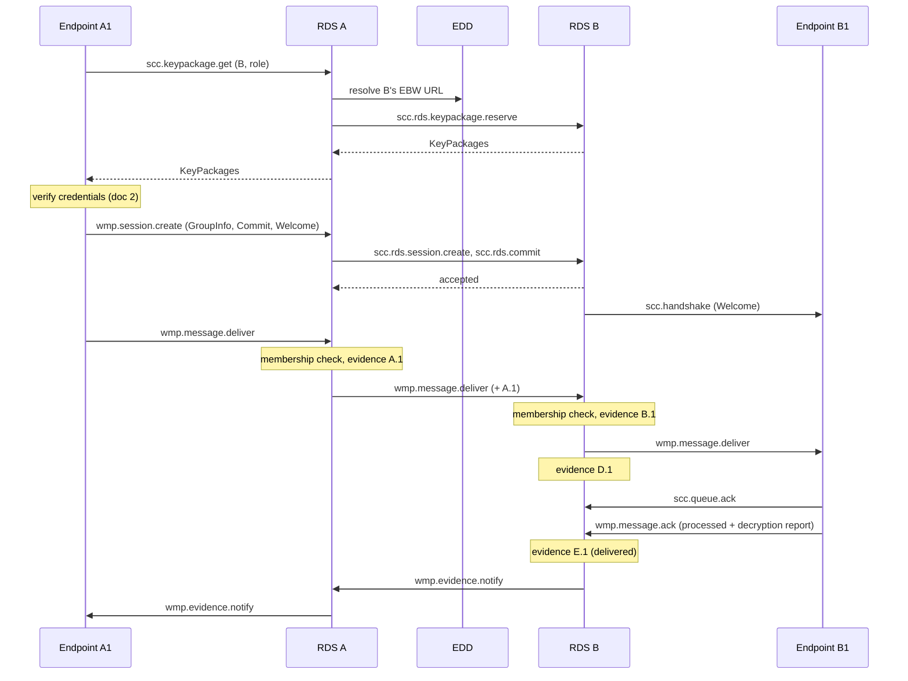

# SCC Specification Set

This directory specifies the Secure Communication Channel (SCC) for the
European Business Wallet.

## Documents

| # | Document | Element | Covers |
|---|---|---|---|
| 1 | [Discovery: EBW URLs and the EDD](01-discovery.md) | Discovery | EBW URLs, registry documents, operation log, provider submissions, directory API, identifiers, lifecycle, acceptance policies |
| 2 | [Endpoint Credentials](02-credentials.md) | Discovery, E2E | Endpoint credentials, the `ebw_endpoint` MLS credential, MultiCredential binding |
| 3 | [MLS Profile](03-mls.md) | E2E | Cipher suites, sessions, Commit logs, membership checks, message format, epoch authenticator |
| 4 | [Delivery](04-delivery.md) | Delivery | JSON-RPC protocol between endpoints and RDSes and between RDSes |
| 5 | [Evidence](05-evidence.md) | Evidence | Evidence objects, decryption reports, retention, dispute resolution |

Machine-readable definitions are in [`schemas/`](schemas/):

| File | Format | Defines |
|---|---|---|
| `common.cddl` | CDDL | Types shared by all documents |
| `discovery.cddl` | CDDL | Operations, submissions, EDD statements |
| `credentials.cddl` | CDDL | Endpoint credentials and requests |
| `mls.cddl` | CDDL | Application message |
| `evidence.cddl` | CDDL | Evidence, decryption reports, consent decisions |
| `edd.openapi.yaml` | OpenAPI 3.1 | EDD HTTP API |
| `delivery.openrpc.json` | OpenRPC 1.3 | Delivery JSON-RPC methods |
| `rds-metadata.schema.json` | JSON Schema | RDS metadata document |

Examples are in [`examples/`](examples/). They are generated with real
signatures by `tools/gen_examples.py`. CBOR examples come in binary
(`.cbor`) and diagnostic notation (`.diag`). Run `make check` from the
repository root to validate every schema and example, and to check that
the CDDL and method tables in these documents match the schema files.

## Architecture

SCC follows the four-corner model of ETSI EN 319 522. Each EBW owner uses
one Registered Delivery Service (RDS). An endpoint talks only to its own
RDS. RDSes talk to each other and to the European Digital Directory (EDD).

```
     EBW owner A                                         EBW owner B
  +--------------+                                    +--------------+
  | Endpoint A1  |--+                              +--| Endpoint B1  |
  +--------------+  |  +-------+      +-------+   |  +--------------+
                    +--| RDS A |------| RDS B |---+
  +--------------+  |  +-------+      +-------+   |  +--------------+
  | Endpoint A2  |--+      |              |       +--| Endpoint B2  |
  +--------------+         |    +-----+   |          +--------------+
                           +----| EDD |---+
                                +-----+
```

| SCC term | ETSI EN 319 522 term |
|---|---|
| EBW owner | Sender or recipient (a legal person) |
| Endpoint | ERD user agent |
| RDS | ERDS (sender's ERDS, recipient's ERDS) |
| EDD and RDS metadata | Common Service Interface (identification and capability lookup) |
| Evidence | ERDS evidence |

An endpoint is a wallet instance or other client that holds MLS keys for
an EBW owner. Endpoints are the only place plaintext exists.

## Overview of a message exchange



## Terminology

- **EBW owner:** a legal person that holds an EBW URL.
- **Registry document:** the identity, keying and routing information
  for an EBW URL, as set by the latest valid operation in its log
  (doc 1).
- **Update key:** a key in the registry document that may sign operations.
- **Credential key:** a key in the registry document that may sign endpoint
  credentials.
- **Endpoint key:** a long-lived key held by one endpoint and certified by
  an endpoint credential (doc 2).
- **Subject ID:** the opaque identifier of an endpoint within its owner's
  EBW URL, carried as `sub` in its credential.
- **Role:** a name for a function within an EBW owner, such as `invoices`.
  An endpoint holds one or more roles.
- **Holder:** the person or system an endpoint acts for. Several endpoints
  can share a holder. Acceptance policies count holders.
- **Address:** an EBW URL and a role. It names a set of endpoints.
- **Home RDS:** the RDS named in an EBW owner's registry document. It
  serves all of that owner's endpoints.
- **Sending RDS / receiving RDS:** the home RDSes of the sender and the
  recipient of a particular message.
- **Session:** an MLS group between two addresses (doc 3). Its session ID
  is the MLS group ID.
- **Connection:** an authenticated transport connection between an
  endpoint and its home RDS, or between two RDSes (doc 4).

## Conventions

The key words MUST, MUST NOT, REQUIRED, SHALL, SHALL NOT, SHOULD, SHOULD
NOT, RECOMMENDED, MAY and OPTIONAL are to be interpreted as described in
BCP 14 (RFC 2119, RFC 8174) when, and only when, they appear in all
capitals.

### Encoding

- Signed and hashed objects are CBOR (RFC 8949) using **deterministic
  encoding** (RFC 8949 §4.2.1). An implementation MUST reject a signed
  object whose payload is not deterministically encoded.
- Objects are defined in CDDL (RFC 8610). Map keys are text strings,
  except where an existing standard uses integers (COSE, CWT).
- Signatures are COSE_Sign1 (RFC 9052) with an embedded payload.
  Detached payloads are not used.
- Signature algorithms are EdDSA with Ed25519 (`-8`) and ECDSA with P-256
  and SHA-256 (`-7`). Implementations MUST support both.
- Public keys are COSE_Key objects (RFC 9052 §7). A key is identified by
  its COSE Key Thumbprint (RFC 9679) using SHA-256.
- Hashes are SHA-256, unless a hash is computed inside MLS, where the
  cipher suite's hash is used.
- Times are unsigned integers counting seconds since 1970-01-01T00:00:00Z,
  without a CBOR tag.
- MLS structures use the TLS presentation language and encoding of RFC
  9420 §2.1.
- In JSON (the delivery protocol), binary values are base64url strings
  without padding (RFC 4648 §5).

### Identifiers

| Identifier | Form | Example |
|---|---|---|
| EBW URL | `ebw:` + 24 base32 characters | `ebw:ytf2ob7mxuljkyweuwq4jpr3` |
| Role | 1 to 32 characters from `a-z`, `0-9`, `-` | `invoices` |
| Subject ID | Opaque, 1 to 64 characters from `A-Z`, `a-z`, `0-9`, `_`, `-` | `Kq7vT2mXr9Lp` |
| Message ID | 16 random bytes | `h'0192f1a3...'` |
| Session ID | 16 to 32 bytes, the MLS group ID | `h'5c0e...'` |
| Evidence ID | 16 random bytes | `h'77a0...'` |

A subject ID identifies an endpoint, like `sub` in a JWT. It is unique
within one EBW URL, and the pair (EBW URL, subject ID) identifies an endpoint
globally. It is opaque: it carries no meaning (doc 2 §2).

The role `default` is reserved. A message addressed to an EBW URL without a
role is addressed to the role `default`. Every EBW owner MUST have at
least one endpoint holding the role `default`.

### Code points

These code points are taken from private-use ranges until registered.

| Registry | Name | Value |
|---|---|---|
| MLS Credential Types | `multi` (from draft-ietf-mls-extensions) | `0x0003` (suggested by the draft) |
| MLS Credential Types | `ebw_endpoint` | `0xF0EB` |
| MLS Extension Types | `scc_session` | `0xF0EC` |
| MLS Signature Labels | `"CredentialBindingTBS"` (from draft-ietf-mls-extensions) | — |

### Labels

Domain-separation labels are ASCII strings beginning with `"SCC 1.0 "`.
They are listed where they are used.

## Status

This is a draft design. It depends on draft-ietf-mls-extensions-10 for
MultiCredential and on draft-ietf-oauth-status-list-21 for credential
revocation.
